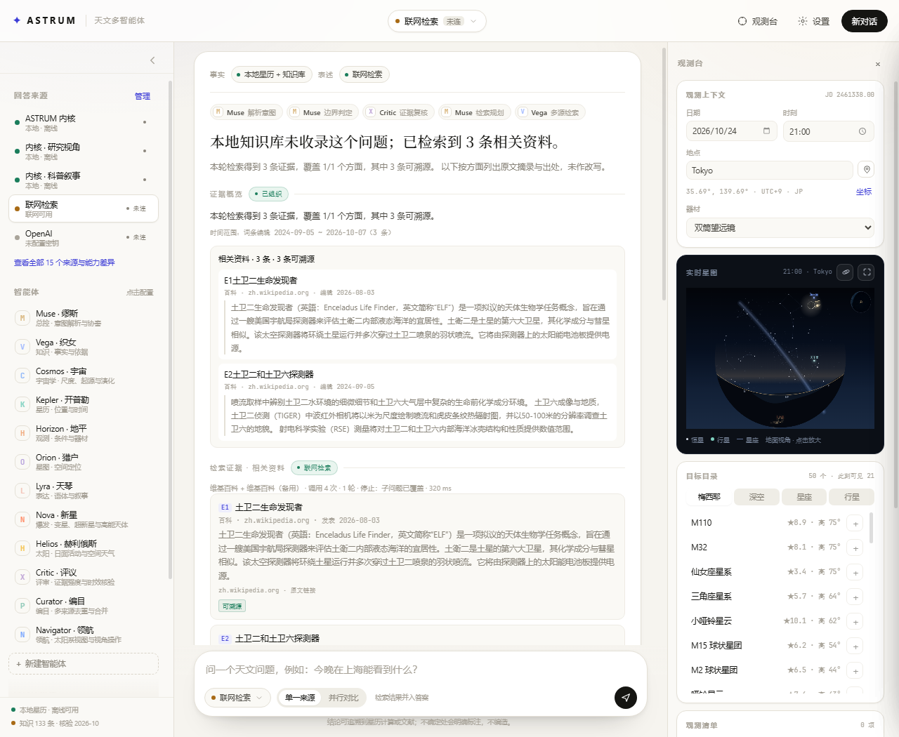

# ASTRUM · 天文多智能体工作台

一个纯静态的天文问答网页。星历在本机复算，事实条目带来源与核验日期，联网检索会多源取证并标注证据强弱。

**不需要安装、不需要后端、不需要 API key 就能用。**（云端模型与联网检索为可选项）

---

## 快速开始

### 方式一：直接打开

下载仓库，双击 `index.html`。

### 方式二：本地起个静态服务（推荐）

```bash
# Python 3
python -m http.server 8080
# 然后打开 http://localhost:8080

# 或者 Node
npx serve .
```

相对 `file://`，用 http 打开更接近真实环境（有正常的 Origin，个别接口对 `file://` 更严格）。

### 方式三：部署到 GitHub Pages

见下方「部署」。

---

## 能做什么

| 能力 | 说明 |
| --- | --- |
| **星历复算** | 天体坐标、升落、中天、可见窗口，全部本地计算，数值可复现 |
| **知识问答** | 160 条天文条目，每条带来源、共识等级与核验日期 |
| **联网检索** | OpenAlex / NASA / 维基百科 / Semantic Scholar 多源聚合，按问题类型选源 |
| **证据分级** | 每条证据标注「可溯源 / 待核验」，跨源数值分歧并列呈现而不擅自取舍 |
| **附件解析** | 图片、文本、**FITS 头信息**（目标/赤经赤纬/曝光/望远镜/滤镜），FITS 解出坐标可直接定位到星图 |
| **多智能体** | 13 个角色各司其职，其中 Scholar 专责论文检索与证据评估 |
| **可选模型** | 本地内核 / Chrome 内置 AI（免密钥）/ 本地 Ollama（免密钥）/ 12 家云端（需自己的 key） |

### 示例问题

- 今晚在北京能看到什么？
- 猎户座大星云的升落时间是几点？
- 为什么超新星爆发能产生那么大的能量？
- 参宿四有多远？
- 这张 M42 的 FITS 拍的是什么？（上传文件后提问）

---

## 截图

答案会先给结论，再列依据、证据概览与引用核验：



上传 FITS 文件后，头信息逐项列出，并可一键在实时星图中定位：


---

## 关于「联网」和「模型」

### 检索数据源（无需 key）

| 源 | 用途 |
| --- | --- |
| OpenAlex | 学术论文 |
| NASA Images API | 天文影像 |
| 维基百科（Core REST / Action API） | 百科条目 |
| Semantic Scholar | 论文补充（**匿名调用共享限流，偶发 429 属正常**） |
| Open-Meteo / Photon / timeapi.io | 地名检索、坐标反查、时区 |
| ipapi / ipwho / ipinfo | IP 定位（可选） |

### 模型来源（可选）

- **本地内核**（默认）：不调用任何模型，直接由本地事实与模板组织表述。完全离线。
- **本机 · Chrome 内置 AI**：设备端 Gemini Nano，免密钥、文本不出设备。需 Chrome 148+ 桌面版、约 22GB 磁盘、4GB 显存。官方多语言列表暂不含中文，中文质量可能不稳定。
- **本地模型**（Ollama / LM Studio / vLLM）：在「设置 → 来源 → 自定义」里填端点，**密钥留空即可**。
  ```
  端点：http://localhost:11434/v1/chat/completions
  模型：qwen2.5:7b
  ```
- **云端**：OpenAI / Anthropic / Gemini / DeepSeek / Moonshot / 智谱 / 通义 / Mistral / Groq / xAI。需要你自己的 key，只存在浏览器 `localStorage`，不会上传到任何服务器。

#### 哪些厂商支持浏览器直连（实测预检）

带 `Authorization` 头的请求必须先过 CORS 预检（OPTIONS）。**预检不放行的厂商，浏览器一定拦得住，任何环境都用不了。**

| 厂商 | 预检放行 | 说明 |
| --- | :---: | --- |
| **通义千问** | ✅ | `Allow-Origin: *`，最宽松，**首选** |
| **Moonshot（Kimi）** | ✅ | 完整回显 Origin |
| **DeepSeek** | ✅ | 完整放行 |
| 智谱（GLM） | ❌ | 预检无任何 `Allow-*` 头，**必须自建代理** |
| OpenAI | ❌ | 不提供 CORS，必须自建代理 |

（以上为 2026-10 实测；不同服务随时可能调整，请以「测试连接」的实际结果为准。）

> 模型只负责「表述层」。换成任何模型都不会改变星历数值与知识库事实。

---

## 部署到 GitHub Pages

1. 把本目录（`astrum/`）作为仓库根目录推送到 GitHub：

```bash
cd astrum
git init
git add .
git commit -m "ASTRUM: 天文多智能体工作台"
git branch -M main
git remote add origin https://github.com/<你的用户名>/<仓库名>.git
git push -u origin main
```

2. 仓库 **Settings → Pages**：
   - Source 选 `Deploy from a branch`
   - Branch 选 `main`，目录选 `/ (root)`
   - 保存，等 1–2 分钟

3. 访问 `https://<你的用户名>.github.io/<仓库名>/`

### 为什么能直接在 Pages 上用

GitHub Pages 只提供静态文件，**不会注入 `Content-Security-Policy` 响应头**。因此页面里那份 `meta` CSP 是唯一生效的策略，而它已放行上述数据源。

如果你把本项目嵌进别的平台预览（例如某些 IDE 的预览面板），对方若注入了自己的 CSP 响应头，浏览器会与 `meta` 取交集，可能导致检索全部失败——这类失败通常在数毫秒内返回，而不是超时。此时请在独立浏览器标签中打开。

## 遇到连接失败时怎么读提示

浏览器把三种完全不同的失败都报成同一个 `TypeError: Failed to fetch`，本项目会尽量把它们分开显示：

| 看到的提示 | 真实原因 | 处理 |
| --- | --- | --- |
| **被当前页面的 CSP 拦截（connect-src 不允许连 xxx）** | 你所在的页面被宿主限制了外连 | 换独立浏览器标签打开本站（GitHub Pages / 本地 http）即可 |
| 网络不可达或该服务未开放浏览器直连（CORS） | 真断网，或该服务不允许浏览器直连（如 OpenAI） | 检查网络；或在「自定义」里填自建代理地址 |
| 触发限流 | 调用过于频繁 | 等一会儿；Semantic Scholar 的 429 尤其常见 |
| 密钥无效 | key 填错或已过期 | 核对后重新填写 |
| 连接超时 | 响应慢或被防火墙拦 | 重试；仍失败则换来源 |

> 关键点：**CSP 拦截通常在几毫秒内失败**，而真网络问题会耗到超时。如果所有来源同时「瞬间失败」，多半是宿主页面限制，不是你的网络或密钥问题。

---

## 隐私

- **没有任何后端**，不收集、不上传任何数据。
- 附件（图片、文本、FITS）**只在本机解析**。仅当你选择云端模型时，文本摘要或图片才会随请求发出。
- API key 存于浏览器 `localStorage`，可用「设置 → 导出配置（不含密钥）」备份其余偏好。
- 页面声明了 `referrer: no-referrer`，不向第三方泄露来源。

---

## 目录结构

```
index.html              入口（多文件版）
astrum-standalone.html  单文件版（构建产物，不入库；node tools/build-standalone.js 生成）
core/
  astro.js              星历与坐标计算
  agents.js             意图解析、答案组装、13 个智能体
  sources.js            模型来源与检索端点
  research.js           检索规划、多轮取证、证据管理、引用核验
  geosearch.js          全球地名检索
  attachments.js        附件解析（含 FITS 头）
  app.js                界面与交互
data/
  knowledge.js          160 条知识条目
  catalog.js            星表（深空 54 / 恒星 132 / 星座 22）
  places.js             城市库
  bodies.js             天体实测资料
tools/
  selftest.js           全功能回归
  research-test.js      检索与证据链路测试
  build-standalone.js   生成单文件版
  sync-csp-hash.js      同步内联脚本的 CSP 哈希
docs/
  DESIGN.md             设计文档与取舍记录
  AUDIT-search-evidence.md  检索链路审计
```

---

## 开发

```bash
# 全功能回归（35 项）
node tools/selftest.js

# 检索与证据链路（离线 mock 77 项）
node tools/research-test.js

# 再加上真实联网测试
node tools/research-test.js --online

# CSP 拦截 / CORS / 断网 三类失败的区分（6 项，需 Chrome）
node tools/csptest.js

# 改了 index.html 的内联脚本后，同步 CSP 哈希
node tools/sync-csp-hash.js

# 重新生成单文件版
node tools/build-standalone.js
```

> 修改 `index.html` 里的内联脚本后**必须**跑 `sync-csp-hash.js`，否则 CSP 会拦截该脚本。

---

## 已知限制

| 限制 | 说明 |
| --- | --- |
| Semantic Scholar | 匿名调用共享限流，频繁出现 429；已在链路中作为可降级来源 |
| 维基百科 | 部分地区网络不可达，检索会自动降级到其他源 |
| Chrome 内置 AI | 需特定硬件；官方语言列表暂不含中文 |
| FITS | 只解析头信息，不解析像素（不做拉伸、伪彩、测光） |
| PDF / DOCX | 暂不解析，按「未解析」标注，不谎称能读 |
| 实时数据 | 云量、空间天气等需外部接口，未接入 |

---

## 许可

未指定许可证。如需开源发布，建议自行添加 `LICENSE`（MIT / Apache-2.0 等）。
