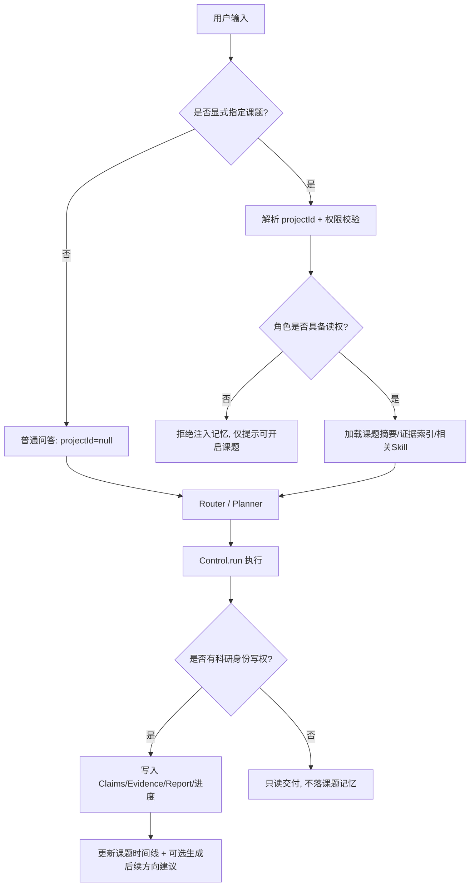

# ASTRUM 身份体系与 Agent 角色架构审计

> 审计类型：只读审计（未修改任何业务代码、测试代码、配置或数据结构）
> 审计对象：`D:\Projects\Astrum` 当前工作区
> 审计日期：2026-11-20
> 结论状态：身份体系**部分存在但未形成权限模型**；科研长期能力**尚不存在**；当前架构**可以承接**科研成长系统，但必须先补齐三处隔离缺陷。

---

## 1. 审计摘要

| 问题 | 结论 | 关键依据 |
|---|---|---|
| 当前身份体系是否存在 | **部分存在**，且分为四层不同含义的「身份」 | 用户档案 `Profile`、用户人格 `PERSONAS`、内置 Agent 名册、自定义 Agent |
| Agent 角色体系是否完整 | **名义完整，执行不独立**：13 个内置 Agent 有名称/职责/参数命名空间，但共享同一套规则引擎与同一段上下文 | `agents.js:189-285`、`agents.js:725`、`Sources` 仅两套提示词 |
| 是否存在身份隔离 | **仅用户档案级有真实隔离**；Agent 级没有任何隔离 | `profile.js:51-53`、`store.js:21-23`、`sources.js:569-620` |
| 是否存在科研身份 | **没有显式「科研身份」**；最接近的是 Scholar / Critic / Curator 三个文献与证据角色 | `agents.js:253-277`、`compose-adapter.js:188-219` |
| 是否已具备科研长期记忆 | **不存在**。只有 8 轮会话内内存记忆，刷新即失；聊天历史可持久化但不是可检索研究记忆 | `agents.js:667-676`、`app.js:2496-2503`、`thread.js:92-99` |
| 当前架构是否适合增加科研成长系统 | **适合，但需先设边界**：任务状态、证据、Claims、报告已有可复用底座；缺的是身份权限模型、课题归属容器、记忆存储 | 见第 6、8 节 |

一句话结论：**ASTRUM 现在有「角色的叙事层」，没有「角色的权限层」。** 直接把长期科研记忆挂到 Agent 上，会造成所有身份共享同一份科研记忆；正确落点应是「科研课题」为记忆边界、「Agent 角色」为访问策略、「用户档案」为偏好与数据隔离边界。

---

## 2. 当前身份与 Agent 清单

### 2.1 四层「身份」概念辨析

| 层次 | 实现名称 | 是否参与运行时判定 | 真实作用 | 证据 |
|---|---|---|---|---|
| L-用户数据 | Profile（档案） | 是 | 决定使用哪个 localStorage 前缀与哪个 IndexedDB 库；切换时整页重载 | `profile.js:51-53`、`app.js:41`、`app.js:6661-6667` |
| L-用户人格 | PERSONAS（observer / researcher / learner） | 是（仅表达参数） | 只改默认 `register`（专业/科普）与 `depth`（精简/标准/详尽），不参与事实与工具选择 | `app.js:6499-6519` |
| L-内置 Agent | AGENTS（13 个） | 是（名称 + 配置 + trace） | 作为规则引擎内部的分工标签、配置命名空间（`cfg.<agent>`）、答案溯源展示 | `agents.js:189-293`、`agents.js:810-813` |
| L-自定义 Agent | CUSTOM（用户创建） | 是（注记 + 章节裁剪 + 参数覆盖） | 在答案尾部插入角色注记、裁剪章节、覆盖部分 `cfg` 参数 | `agents.js:930-1007`、`app.js:5222-5244` |

> 结论：ASTRUM 的「身份」不是一个实体，而是上述四层叠加。**没有任何一层是"某 Agent 拥有独立 System Prompt / 独立记忆 / 独立工具权限"意义上的身份。**

### 2.2 内置 Agent 完整清单（13 个）

来源：`core/agents.js:189-285`（数组 `AGENTS`），运行时索引 `AGENT_BY_ID`（`agents.js:286-287`）。已用只读脚本核对：13 个 id 唯一，`defaultConfig()` 生成 13 个配置命名空间。

| # | id | 名称 | 职责（代码原文） | 提示词位置 | 调用入口 | 独立上下文 | 科研职责 |
|---|---|---|---|---|---|---|---|
| 1 | `muse` | Muse 缪斯 | 总控 · 意图解析与协奏 | **无独立提示词**；LLM 综合时复用 `Sources.museSysPrompt`（全局唯一） | `buildAnswer` 入口 + `Sources` synthesis | 否 | 跨类（含科研综合） |
| 2 | `vega` | Vega 织女 | 知识 · 事实与依据 | 无 | `composeTarget` / `composeEvent` 等 | 否 | 辅助 |
| 3 | `cosmos` | Cosmos 宇宙 | 宇宙学 · 尺度、起源与演化 | 无 | `composeCosmos`（`agents.js:1740+`） | 否 | 辅助（领域解释） |
| 4 | `kepler` | Kepler 开普勒 | 星历 · 位置与时间 | 无（纯计算） | `composeTarget` 内星历分支 | 否 | 辅助（计算） |
| 5 | `horizon` | Horizon 地平 | 观测 · 条件与器材 | 无 | `scoreTarget` / `composeGearFit` | 否 | 辅助 |
| 6 | `orion` | Orion 猎户 | 星图 · 空间定位 | 无 | `composeChart` 等 | 否 | 辅助 |
| 7 | `lyra` | Lyra 天琴 | 表达 · 语体与叙事 | 无 | `composeTarget` 末尾组织表述 | 否 | **否**（纯表达） |
| 8 | `nova` | Nova 新星 | 爆发 · 变星、超新星与高能天体 | 无 | `composeNova` | 否 | 辅助（领域解释） |
| 9 | `helios` | Helios | 太阳 · 日面活动与空间天气 | 无 | `composeHelios` | 否 | 辅助（领域解释） |
| 10 | `scholar` | Scholar 研读 | 文献 · 论文检索与证据评估 | **无独立提示词**；配置经 `research.js` 的 `opts.scholar` 传递 | `Research.run` → `toSections`；`registry.paper.search` | 否 | **是** |
| 11 | `critic` | Critic 评议 | 评审 · 证据强度与时效核验 | 无 | `criticReview`（`agents.js:816`）+ Control `postCritic` | 否 | **是**（评审） |
| 12 | `curator` | Curator 编目 | 编目 · 多来源去重与合并 | 无 | `research.js` 去重/`compare.curate` | 否 | **是**（辅助判断） |
| 13 | `navigator` | Navigator 领航 | 领航 · 太阳系视图与视角操作 | 无 | 视图指令解析 `meta.systemAction` | 否 | **否** |

补充事实：

- 13 个 Agent 共享同一份 `ATTRS` 参数体系（10 项），见 `agents.js:176-187`。
- 所有 Agent 的「职责」都是**描述性字符串**，没有任何一个被用于权限判定或工具过滤。
- `docs/architecture/04-Agent职责与协作规范.md` 把 13 个 Agent 分为"决策型 4 / 领域计算型 6 / 展示型 3"，但该分类**未落地为代码约束**；代码中只有 `TRACE_ORDER` 的展示排序（`agents.js:810-813`）。

### 2.3 自定义 Agent

用户可创建自定义 Agent，字段包括名称、角色、人设（`persona`）、意图匹配（`intents`）、权重、章节开关、专家注记（`directive`，上限 220 字）、参数覆盖。

| 能力 | 实现 | 说明 |
|---|---|---|
| 注册 | `AGENT_BY_ID[id] = {...custom:true}`（`agents.js:939-947`） | 与内置 Agent 混入同一 id 空间 |
| 匹配 | `matchCustom(intent)`（`agents.js:949-955`） | 按意图 + 权重排序，最多取 3 条注记 |
| 生效方式 | `applyCustom`（`agents.js:957-992`） | 裁章节 + 插入 `kind:'custom'` 注记 + 追加 trace |
| 参数覆盖 | `applyCustomConfig`（`agents.js:994-1007`） | 写入 `cfg`，影响语气/深度等 |

> 自定义 Agent 没有任何独立运行上下文，也不影响检索与工具调用；它是**答案排版与口吻的插件**，不是独立智能体。

### 2.4 数量与关系结论

1. **Agent 数量**：内置 **13** 个；自定义数量由用户数据决定（无上限代码约束，仅 UI 管理）。
2. **身份与 Agent 的关系**：名义上**多对多**——一个用户人格可触发多个 Agent 的 trace，一个 Agent 可服务所有人格；执行上是**同一引擎内的多个标签**。
3. **是否存在多个 Agent 共享同一身份**：是。所有 Agent 共享同一个 `ctx`、同一份 `cfg`、同一个 `MEMORY`、同一个答案对象。
4. **是否存在一个身份调用多个 Agent**：是，但只是 `trace` 数组与 `meta.agents` 的记录，不是并行进程。`answer.meta.agents` 示例实测：`["muse","cosmos","vega","orion","lyra"]`。
5. **是否存在普通对话与科研模式的明确区分**：**没有产品级模式开关**。只有：
   - `state.settings.mode` 的 `single / compare`（`app.js` 设置项）；
   - Router 自动判定的 `single / compare / research`（`router.js:145-151`）；
   - `research` 是**按问句自动推断**的路径，不是用户可选择的身份或模式。
6. **是否存在用户可主动选择的身份**：存在**用户人格**三选一（`app.js:6502-6506`），只影响表达；不存在"选择某个 Agent 对话"的入口。

---

## 3. 真实调用链

### 3.1 主链路（当前代码）

```mermaid
flowchart TD
    A[用户输入 ask&#40;text&#41;] --> B[normalizeQuery 规范化]
    B --> C[AC.findCity 定位城市]
    C --> D[Thread.appendUser 持久化用户消息]
    D --> E[readCtx 读取时间/地点/器材]
    E --> F[AC.setMemory&#40;state.memory&#41;]
    F --> G{AstroRequest.classify}
    G -->|legacy: smalltalk / unknown 非科研 / single+L1| H[AC.buildAnswer 规则引擎]
    G -->|control: L2-L4| I[AstroControlBridge.canControl]
    I -->|是| J[AstroControl.run]
    I -->|否| H
    J --> K[Router.route 决定 single/compare/research]
    K --> L[Planner 选 T-A…T-G 模板]
    L --> M[TaskState 初始化 + TaskStore 持久化]
    M --> N[Orchestrator Scheduler 分批]
    N --> O[Runner.executeOne 调 Registry 工具]
    O --> P[Registry 12 个工具: kepler/kb/evidence/simbad/paper/llm/fits/compare/compose.*]
    P --> Q[compose-adapter: Evidence → Claims → Reducer → Report]
    Q --> R[Critic / Evaluator 判定]
    H --> S[ans.sections + ans.trace + ans.meta]
    R --> S
    S --> T{来源类型}
    T -->|local| U[renderAnswer 本地渲染]
    T -->|web| V[Research.run 检索 → applyResearch → renderAnswer]
    T -->|cloud/device| W[Research.run → Sources.streamChat 流式表述]
    U --> X[Thread.appendBot 保存完整 ans]
    V --> X
    W --> X
    X --> Y[recordSkill + rememberAnswer 更新 MEMORY]
```



关键代码位置：

| 阶段 | 函数 | 位置 |
|---|---|---|
| 唯一入口 | `ask(text)` | `app.js:3936` |
| 指代/记忆注入 | `AC.setMemory` / `resolveByMemory` | `app.js:3985`、`agents.js:684` |
| 路由判定 | `AstroRequest.classify` | `request.js:17-42` |
| 分流闸门 | `AstroControlBridge.canControl` | `control-bridge.js:26-38` |
| 控制执行 | `AstroControl.run` | `control.js:173` |
| 模板规划 | `AstroPlanner.plan` | `planner.js:483` |
| 调度执行 | `Orchestrator.Scheduler/Runner` | `orchestrator.js:94-110`、`orchestrator.js:220-355` |
| 工具注册 | `AstroRegistry` | `registry.js:37-190`、`registry.js:579` |
| 研究综合 | `compose-adapter.researchOf` | `compose-adapter.js:188-219` |
| 本地规则引擎 | `AgentCore.buildAnswer` | `agents.js:725` |
| 结果持久化 | `Thread.appendBot` | `thread.js:92-99` |

### 3.2 科研问题链路（T-E / T-F）

```mermaid
flowchart LR
    A[问句] --> B[detectIntent]
    B --> C[Router.isResearchQuestion]
    C -->|命中研究词且非纯定义式| D[mode=research]
    D --> E[Planner 选 T-E 或 T-F]
    E --> F[simbad.tap → paper.search → evidence.search]
    F --> G[Research.run 多轮检索/去重/冲突检测]
    G --> H[compose.domain]
    H --> I[Claims.buildClaimsFromEvidence]
    I --> J[Claims.judgeAll 生成 verdict]
    J --> K[Reducer.reduce 去重/冲突/事实分级]
    K --> L[Report.build 结构化研究报告]
    L --> M[postCritic 复核]
    M --> N[answer.research + sections]
```



证据：`router.js:21-26`（研究问题判定）、`router.js:148`（mode 判定）、`planner.js:34-44`（T-E/T-F 模板）、`research.js:602-647`（多轮检索）、`compose-adapter.js:188-219`（Claims/Reducer/Report）。

### 3.3 身份在链路中的实际位置

- 用户人格只在 `app.js:3994-4000` 参与**单题风格切换**：`cfgRun.vega.scope`、`cfgRun.muse.depth` 两个字段。
- 身份（人格）**不进入** `Sources` 的 system prompt：`buildRequest(payload)` 只读取 `question / facts / evidence / memory / tone / answerMode`（`sources.js:494-620`），没有任何 `persona` 或 `agent` 字段。
- Agent 名称只在 `answer.trace` 与 `answer.meta.agents` 出现，用于渲染溯源（`agents.js:642-648`、`agents.js:810-813`）。
- 结论：**身份识别不参与 Agent 调度，Agent 调度只依赖 Intent + Route + Plan。**

---

## 4. 隔离机制审计

| 隔离维度 | 是否具备 | 真实实现 | 结论 | 证据 |
|---|---|---|---|---|
| 身份隔离 | 部分 | Profile 命名空间 + 人格标签 | 用户档案之间隔离真实；Agent 之间无身份实例 | `profile.js:51-53`、`app.js:41` |
| 提示词隔离 | **无** | 全局仅 2 套 system prompt：「表述层」与「Muse 综合层」 | 所有 Agent、所有人格共用 | `sources.js:320-351`、`sources.js:420-464` |
| 上下文隔离 | **弱** | 每次 `ask` 新建 `ctx`，但 `MEMORY`、`cfg`、`skills` 为页面级共享；`ctx` 含 `cityRef` 引用 | 并发/串行请求共享可变状态；浅拷贝无法隔离嵌套引用（测试已证实） | `app.js:3983-3985`、`ctx-isolation-test.js` A/B 用例 |
| 记忆隔离 | **无** | `MEMORY` 为模块级数组，最多 8 条，`setMemory` 全量覆盖 | 所有身份、所有 Agent、所有 Thread 共用一份 | `agents.js:667-676`、`app.js:2496-2503` |
| Thread 隔离 | 部分 | 消息按 `threadId` 存储；`Thread.setCurrent` 切换 | 历史消息隔离；**MEMORY 切换 thread 时不清空**（对比 `newChat` 会清） | `store.js:187-200`、`thread.js:123-130`、`app.js:6761-6775` vs `app.js:1058-1065` |
| Task 隔离 | 部分 | `TaskState.id` 独立，Step/Event 完整 | 任务之间隔离；**TaskStore 未按 Profile 命名空间**，跨档案共用库 | `task-store.js:12-15`、`control.js:26-55` |
| Skill 隔离 | **无** | `state.skills` 按 `intent|target` 聚合，上限 40 | 无 Agent 维度、无课题维度；仅作为器材默认值提示 | `app.js:2141-2166`、`agents.js:2300-2301`、`agents.js:2520` |
| 工具隔离 | **无** | Registry 12 个工具声明 `caps`/`permissions`，但不含 agent 归属 | 任何路径都能调用任何工具；权限是"工具能力"不是"角色权限" | `registry.js:37-190`、`registry.js:502-575` |
| 数据隔离 | 部分 | Profile 级 IndexedDB/localStorage 隔离；单档案内无更细粒度 | 同一档案内所有 Agent 可见全部数据 | `store.js:21-23`、`profile.js:51-53` |
| 持久化隔离 | 部分 | 档案、线程、消息、设置按 Profile 隔离；**任务库不隔离** | 刷新后任务归属不随档案切换 | `task-store.js:12-15` |

### 4.1 必须区分的程度差异

| 说法 | 是否成立 | 说明 |
|---|---|---|
| 「不同身份使用不同提示词」 | **不成立** | 只有 2 套全局提示词 |
| 「不同 Agent 只是名称不同」 | **基本成立** | 名称 + 参数命名空间 + 注记，无独立提示词 |
| 「不同 Agent 有独立上下文」 | **不成立** | 共享 `ctx`、`cfg`、`MEMORY`、`answer` |
| 「不同 Agent 有独立记忆」 | **不成立** | 记忆是页面级单一数组 |
| 「不同 Agent 有独立数据权限」 | **不成立** | 数据权限只有档案级 |
| 「用户档案之间有隔离」 | **成立** | 独立 DB/键 + 切换重载 |

### 4.2 具体风险点（已实证）

1. **MEMORY 跨线程泄漏**：`openThread` 只重绘消息，不调用 `AC.clearMemory()`（`app.js:6761-6775`）；`newChat` 才清（`app.js:1063-1064`）。在 A 对话问「它距离多少」，切到 B 对话再问「它质量多少」，指代可能解析到 A 对话的目标。
2. **任务跨档案泄漏**：`task-store.js:12-15` 固定 `DB_NAME='astrum.tasks.v1'`、`LS_KEY='astrum.tasks.v1'`，未经过 `Profile.ns()`。B 档案刷新后会看到 A 档案未完成的研究任务，且能"继续任务"。
3. **身份信息不落盘到消息**：`Thread.appendBot` 只存 `ans`；`ans` 中没有 persona/agent 身份字段（`thread.js:92-99`）。恢复历史后无法判断"这条答案当时以什么身份生成"，只能从 `ans.meta` 间接推断。
4. **自定义 Agent 注记进入正文**：`applyCustom` 将 `directive` 插入 `sections`（`agents.js:978-988`），与事实章节混排；这是产品设计，但对"事实/角色观点"的边界需要显式标注。

---

## 5. 科研身份分类

### A. 明确的科研身份

| Agent | 理由 | 现有能力 | 缺口 |
|---|---|---|---|
| **Scholar** | 唯一显式声明文献检索与证据评估职责，含职责范围/适用场景/限制三段说明（`agents.js:256-260`） | 检索词构造、论文检索去重、DOI/预印本标注、证据强弱 | 无跨会话文献库、无课题归属、无阅读笔记 |
| **Critic** | 交付前证据复核与门槛判定（`agents.js:816-890`），Control 层 `postCritic` | 证据条数/共识等级/边界检查、verdict | 评审结果不持久，不形成经验 |
| **Curator** | 多来源去重与合并、保留差异（`research.js` 去重 + `compare.curate`） | 去重键、冲突保留 | 无跨轮次合并记忆 |

### B. 科研辅助身份

| Agent | 参与方式 |
|---|---|
| **Vega** | 星表/知识库事实核验，为科研结论提供本地依据 |
| **Kepler** | 星历/坐标/可见性计算，为观测类研究提供数值 |
| **Horizon** | 观测条件、器材匹配 |
| **Orion** | 星图定位与可视化 |
| **Cosmos / Nova / Helios** | 领域解释与共识分级（内容偏科研，但职责是"解释"而非"研究管理"） |
| **Navigator** | 视图操作，不参与科研判断 |

### C. 非科研身份

| 身份 | 说明 |
|---|---|
| **Lyra** | 纯表达层，不得改变事实 |
| **用户人格 learner / observer** | 只影响讲解方式，不应获得科研记忆写入权 |
| **用户人格 researcher** | **准科研**：偏好专业语体与深度，但没有科研任务管理能力；不应仅凭此身份获得写入权 |

### 5.1 权限维度必须分开（当前全部不存在）

| 权限 | 现状 | 说明 |
|---|---|---|
| 执行科研任务 | 任何人任何问句都可进入 T-E/T-F | 无角色门禁 |
| 读取科研记忆 | 无科研记忆可读 | — |
| 写入科研记忆 | 无 | — |
| 创建/修改科研 Skill | 无（现有 skills 只按意图聚合） | — |
| 管理长期科研课题 | 无课题数据结构 | — |

---

## 6. 现有能力复用清单

| 模块 | 已有能力 | 可复用程度 | 证据 |
|---|---|---|---|
| **MEMORY** | 页面级 8 轮 `{q,a,target,at}`，用于指代消解 | 低（无持久化、无归属、无检索） | `agents.js:667-712` |
| **Thread** | 线程 CRUD、消息持久化、完整 `ans` 回放 | **高**（可承载课题对话） | `thread.js:27-160`、`store.js:129-200` |
| **TaskState / TaskStore** | 计划、步骤、事件、预算、取消、恢复、viewOnly 判定 | **高**（已是"研究任务"雏形），但需加 Profile 命名空间 | `task.js`、`task-store.js:60-190`、`control.js:431-496` |
| **Evidence** | 证据规范化、去重、核验、引用审计 | **高** | `evidence.js:541`、`compose-adapter.js:178-186` |
| **Claims** | 从证据构建 Claim、支持/矛盾判定、verdict 汇总 | **高**（已是科研结论的最小单元） | `claims.js:922-940`、`compose-adapter.js:188-219` |
| **Reducer** | 证据去重、冲突识别、事实/推断分级 | 高 | `reducer.js:1-9`、`reducer.js:380` |
| **Report** | 结构化研究报告（问题/对象/结论/参数/论文/冲突/缺口） | 高 | `report.js:1-8`、`report.js:371` |
| **Skill** | `intent|target` 聚合计数 + 上次结论 + 器材 | 低（不是可执行技能，无 Agent 绑定） | `app.js:2141-2166` |
| **Evaluator** | 进度判定 continue/append/replan/stop | 中（可扩展为科研评估器） | `evaluator.js:17-47`、`evaluator.js:408` |
| **Feedback** | 用户主动反馈分类、诊断上下文、脱敏 | 中（可作为人工评估入口，不是自动自评） | `feedback.js:33-54` |
| **Profile** | 档案级数据隔离 | **高**（现成的隔离基座） | `profile.js:51-53` |
| **Workspace** | 观测工作空间/清单/CSV | 无关（是观测计划，不是研究课题） | `workspace.js:1-8` |
| **Topics** | 首屏产品介绍页内容 | 无关 | `topics.js:1-8` |

### 6.1 能力状态判定

| 能力 | 状态 |
|---|---|
| 长期记忆机制 | ❌ 不存在（仅页面内 8 轮；聊天历史可持久化但不构成可检索记忆） |
| MEMORY 级别 | 页面级（不属用户/Thread/Agent 任何一级） |
| 不同 Agent 独立记忆 | ❌ |
| 跨 Thread 记忆检索 | ❌（`Thread.list` 仅返回元数据，无内容检索） |
| 科研课题/项目数据结构 | ❌（全仓库 grep `课题|研究项目|projectId` 无命中） |
| 科研任务暂停与恢复 | ✅ 已有（未完成步骤恢复、viewOnly 判定） |
| Skill 注册/调用/管理 | ⚠️ 部分（只有"问答沉淀"统计，不是可执行技能注册表） |
| Skill 绑定 Agent/身份 | ❌ |
| 任务结果质量评估 | ⚠️ 部分（Critic gate + Claims verdict + Evaluator，但不存档、不学习） |
| 研究经验自动沉淀 | ❌ |

---

## 7. 当前架构存在的问题

### P0（阻塞科研成长系统落地）

**P0-1 不存在「身份 → 记忆/工具」权限模型**
任何问句都能进入研究模板，任何 Agent 名称都能出现在任何答案中。若直接新增科研记忆，将出现"普通问答也能读/写科研记忆"的越权。证据：`registry.js:37-190` 无 agent 归属；`control.js:26-55` 无角色参数。

**P0-2 TaskStore 未按 Profile 命名空间**
`task-store.js:12-15` 固定库名与键名，`app.js:8342-8393` 又直接列出全部任务并提供"继续"。多档案共用设备时，A 的科研任务会出现在 B 的档案中并可被继续执行。这是**数据隔离缺陷**，也是科研课题归属的前置障碍。

### P1（影响科研连续性）

**P1-1 MEMORY 跨 Thread 泄漏且不持久**
`openThread` 不清理 `MEMORY`（`app.js:6761-6775`）；`MEMORY` 也不写入存储。结果：同一档案内跨对话指代污染，刷新后上下文丢失，无法支撑"研究进度恢复"。

**P1-2 Agent 级没有实例边界**
所有 Agent 共用 `cfg`、`MEMORY`、`skills`、`ctx`。若未来给某个 Agent 单独挂记忆，必须先引入"角色会话上下文"，否则记忆会写入全局。

**P1-3 科研产物不可检索、不可归属**
Claims/Report 随 `ans` 存入消息（`thread.js:92-99`），但没有课题 id、没有索引、没有跨线程聚合。用户无法"继续上周的课题"，系统也无法"基于已有成果提出方向"。

### P2（一致性与文档）

**P2-1 文档与实现不一致**
`docs/architecture/04-Agent职责与协作规范.md` 描述"决策型/计算型/展示型"及并行能力，代码中只有 `TRACE_ORDER` 展示排序；Planner 只有 7 个固定模板（`planner.js:13-50`），无 Agent 级并行编排。

**P2-2 自定义 Agent 注记混入事实区**
`applyCustom` 直接向 `sections` 插入 `kind:'custom'`（`agents.js:978-988`）。建议未来在渲染层显式区分"角色观点"与"事实"，避免科研场景误引。

**P2-3 部分统计键未命名空间**
`astrum.stats`（`app.js:6876`）、`astrum.tasks.v1`（`task-store.js:15`）未走 `Profile.ns()`；后者属 P0-2，前者只影响统计。

---

## 8. 科研成长系统接入建议

### 8.1 核心边界：以「科研课题」为记忆单元，而非 Agent

推荐三层归属：

```
用户档案 Profile（数据隔离 + 研究偏好）
   └── 科研课题 ResearchProject（记忆/证据/Skill/进度 的唯一边界）
          ├── 角色访问策略 RolePolicy（scholar/critic/curator 可写；vega/kepler 只读）
          └── 课题产物（问题树、Claims、Evidence、报告、复盘、Skill）
```

理由（基于代码事实）：

1. Agent 没有实例边界（P1-2），给每个 Agent 建独立记忆等于重写运行时。
2. 科研本身是多角色协同：Scholar 检索、Critic 评议、Curator 合并、Muse 综合，天然共享同一课题上下文。
3. TaskState 已有"一次研究任务"的完整结构（`task.js`），课题只是"多次任务的容器"，改造成本最低。
4. Profile 已提供真实隔离（`profile.js`），课题挂在 Profile 下即可复用现有数据隔离。

### 8.2 推荐数据归属

| 数据 | 归属层级 | 理由 |
|---|---|---|
| 研究偏好（关注领域、证据门槛、语言） | 用户级（Profile settings） | 跨课题稳定 |
| 课题元数据（标题、问题、状态、时间线） | 课题级 | 记忆边界 |
| 证据 / Claims / 报告 | 课题级（引用 Task 产物） | 已存在结构，直接挂载 |
| 研究 Skill（检索策略、评估清单） | 课题级 + 角色标签 | 避免跨课题污染；可按角色复用 |
| 对话线程 | 课题级（thread 增加 `projectId`，可空） | 保持旧线程兼容（空 = 普通对话） |
| 任务 TaskState | 课题级（可选 `projectId`） | 恢复时能回到课题 |

### 8.3 角色权限矩阵（建议）

| 角色 | 执行科研任务 | 读课题记忆 | 写课题记忆 | 改课题 Skill | 管课题 |
|---|---|---|---|---|---|
| scholar | ✅ | ✅ | ✅（文献/证据） | ✅ | ❌ |
| critic | ✅ | ✅ | ✅（评审结论） | ✅ | ❌ |
| curator | ✅ | ✅ | ✅（合并结果） | ✅ | ❌ |
| muse | ✅ | ✅ | ✅（综合结论） | ❌ | ❌ |
| vega / kepler / horizon / orion | ✅（辅助） | ✅ 只读 | ❌ | ❌ | ❌ |
| lyra / navigator | ✅（表达/视图） | ❌ | ❌ | ❌ | ❌ |
| 普通问答（无课题） | ❌ | ❌ | ❌ | ❌ | ❌ |

> 关键原则：**"能参与科研任务" ≠ "能读写科研记忆"**。执行权与记忆权必须分开声明。

### 8.4 非科研身份的访问策略

- 默认 `projectId = null`，普通问答**不加载任何课题记忆**。
- 若用户显式引用课题（"我上周研究的那个星系团"），由 Router 识别为 `project-ref`，只注入 `project.summary`（脱敏结论摘要），不注入原始证据与 Skill。
- learner / observer 人格不自动获得课题摘要，需用户主动指定。

### 8.5 保持静态部署与迁移兼容

1. 新增 `astrum.research.v1`（IndexedDB，按 `Profile.ns`），**不改** `astrum.tasks.v1` 的旧键；任务记录增加可选 `projectId` 字段，旧记录无此字段时视为独立任务。
2. 导出格式 `schema:1` 保持不变，新增 `projects` 数组；导入时缺省为空，旧导出仍可用。
3. 所有新增写入走"课题 → 任务 → 线程"的单向引用，不做跨库事务。
4. 不引入后端；课题检索用 IndexedDB 索引（`profileId + updatedAt`）。

### 8.6 推荐调用流程



### 8.7 不建议的做法

- ❌ 给 13 个 Agent 各建一套 Memory：与现有共享引擎冲突，且科研需要跨角色共享。
- ❌ 用 `state.skills` 直接升级为科研 Skill：它没有角色/课题维度，也没有可执行语义。
- ❌ 把 `MEMORY` 扩成长期记忆：它是页面级指代缓存，不是研究记录结构。

---

## 9. 后续实施路线（不实施，仅建议）

| 阶段 | 目标 | 关键改动（建议） | 验收 |
|---|---|---|---|
| **S0 隔离修复** | 消除 P0/P1 数据归属缺陷 | TaskStore 加 Profile 命名空间；MEMORY 绑定 threadId 并在切换时重建；新增只读 `role-policy.js` 声明角色能力 | 多档案任务互不可见；跨线程指代不串；旧测试全绿 |
| **S1 课题数据层** | 引入 ResearchProject 容器 | 新增 `research-store.js` + `project.js`（纯数据结构）；thread/task 增加可空 `projectId` | 课题 CRUD、线程归属、导出兼容 |
| **S2 权限门** | 角色级读写门禁 | Planner 注入前校验角色；写记忆入口统一走 `project.record()` | 普通问答不写入；lyra 不可写；拒绝路径有可见提示 |
| **S3 记忆沉淀** | Claims/Report/进度入课题 | 复用 `claims.js`/`report.js` 产物，追加课题时间线与复习条目 | 课题可跨会话恢复并展示上次结论 |
| **S4 科研 Skill** | 课题级技能沉淀 | 检索策略/评估清单结构化；绑定 `role` + `projectId` | 技能可复用且不跨课题污染 |
| **S5 方向建议与自评** | 基于课题产物生成后续方向 | 用既有 Claims 缺口 + Evaluator 生成待验证问题，标记为"建议"而非事实 | 建议可追溯、可拒绝、不写入事实层 |

> 顺序理由：S0 不解决，S1 之后的数据仍会串档案；S2 不先做，S3 的写入无法限制身份。

---

## 10. 证据索引

| # | 结论 | 文件 | 函数/符号 | 行号 | 实际行为 |
|---|---|---|---|---|---|
| 1 | 内置 Agent 共 13 个 | `core/agents.js` | `AGENTS` | 189-285 | 13 个对象，含 id/name/cn/role/desc/attrs/defaults |
| 2 | Agent 按 id 建索引 | `core/agents.js` | `AGENT_BY_ID` | 286-287 | 注册表供 UI 与配置使用 |
| 3 | 每个 Agent 有独立参数命名空间 | `core/agents.js` | `defaultConfig` | 289-293 | 生成 `cfg.<agentId>`，13 个键 |
| 4 | Agent 无独立提示词 | `core/agents.js` | `AGENTS` 字段 | 189-285 | 键集合中无 prompt/systemPrompt；实测 `hasPrompts:false` |
| 5 | 全局仅 2 套 system prompt | `core/sources.js` | `sysPrompt` / `museSysPrompt` | 320-351、420-464 | 「表述层」与「Muse 综合层」 |
| 6 | 提示词不含身份/Agent 字段 | `core/sources.js` | `buildRequest` | 569-620 | body 只含 model/temperature/messages/system |
| 7 | 意图识别不接收身份 | `core/agents.js` | `detectIntent(text, targets)` | 475 | 仅文本 + 目标 |
| 8 | 用户人格仅 3 种且只改表达 | `core/app.js` | `PERSONAS` / `applyPersona` | 6499-6519 | 写 `register`/`depth` |
| 9 | 单题自动换风格 | `core/app.js` | `detectStyle` | 3994-4000、6523-6534 | 只改 `vega.scope`/`muse.depth` |
| 10 | 路由只依赖意图与复杂度 | `core/router.js` | `route` / `complexityOf` | 129-200 | 返回 mode/level/legacy |
| 11 | 统一入口分流 | `core/request.js` | `classify` | 17-42 | legacy vs control |
| 12 | 控制层闸门 | `core/control-bridge.js` | `canControl` | 26-38 | 按来源类型/附件/mode 判定 |
| 13 | 模板固定 7 个，无 Agent 编排 | `core/planner.js` | `TEMPLATES` / `plan` | 13-50、483 | 步骤只有 tool/deps，无 agent 字段 |
| 14 | 工具注册 12 个，无 agent 归属 | `core/registry.js` | `SPECS` / `register` | 37-190、502-575 | 权限字段只有 canProduceNumbers 等 |
| 15 | 调度按依赖分批，不按 Agent | `core/orchestrator.js` | `nextBatch` / `executeOne` | 94-110、220-355 | 并行上限 4，compose 串行 |
| 16 | 任务状态持久化 | `core/task-store.js` | `create/save/list` | 84-190 | IndexedDB → localStorage → memory |
| 17 | 任务库未按档案隔离 | `core/task-store.js` | `DB_NAME` / `LS_KEY` | 12-15 | 固定 `astrum.tasks.v1` |
| 18 | 任务恢复入口 | `core/app.js` | `offerResumeTask` | 8340-8393 | 列出 resumable 任务并"继续任务" |
| 19 | 档案隔离基座 | `core/profile.js` | `ns` / `switchTo` | 51-53、80-85 | 默认档案沿用旧键，新档案加前缀 |
| 20 | 档案切换整页重载 | `core/app.js` | `renderProfileSwitch` | 6661-6667 | `P.switchTo(id); location.reload()` |
| 21 | 线程消息持久化 | `core/store.js` | `appendMessage` | 157-185 | 写后回读校验 |
| 22 | 线程切换不清记忆 | `core/app.js` | `openThread` | 6761-6775 | 仅重绘消息 |
| 23 | 新对话才清记忆 | `core/app.js` | `newChat` | 1058-1065 | `state.memory=[]; AC.clearMemory()` |
| 24 | 记忆为页面级 8 轮 | `core/agents.js` | `MEMORY` / `setMemory` | 667-676 | 全量覆盖，无持久化 |
| 25 | 记忆写入 | `core/app.js` | `rememberAnswer` 片段 | 2496-2503 | 截断 120/160 字，最多 8 条 |
| 26 | Agent trace 叙事 | `core/agents.js` | `step` / `TRACE_ORDER` | 642-648、810-813 | trace 仅展示排序 |
| 27 | Critic 复核 | `core/agents.js` | `criticReview` | 816-890 | 证据/边界/共识检查，输出 verdict |
| 28 | 自定义 Agent 注册与注记 | `core/agents.js` | `setCustomAgents` / `applyCustom` | 939-992 | 裁章节 + 插入 directive |
| 29 | 自定义 Agent 参数覆盖 | `core/agents.js` | `applyCustomConfig` | 994-1007 | 写 cfg |
| 30 | 技能沉淀 | `core/app.js` | `recordSkill` / `skillFor` | 2141-2166、2060-2065 | `intent|target` 计数，上限 40 |
| 31 | 技能解析器仅用于器材 | `core/agents.js` | `setSkillResolver` | 2300-2301、2520 | `gear-fit` 默认值 |
| 32 | 研究检索多轮 | `core/research.js` | `run` | 602-647 | 预算 maxRounds/maxCalls/budgetMs |
| 33 | 研究画像 | `core/research.js` | `PROFILES` | 42-88 | 机制/对象/参数/最新/事件/通用/本地 |
| 34 | Claims 运行时构建 | `core/compose-adapter.js` | `researchOf` | 188-219 | Evidence → Claims → Reducer → Report |
| 35 | Claims 契约与判定 | `core/claims.js` | `buildClaimsFromEvidence` / `judgeAll` | 922-940 | Claim 无 confidence；R1-R4 规则 |
| 36 | 报告结构 | `core/report.js` | `build` | 1-8、371 | 结论必须带 evidenceRefs |
| 37 | 进度评估 | `core/evaluator.js` | `AstroEvaluator` | 17-47、408 | continue/append/replan/stop |
| 38 | 反馈分类（人工） | `core/feedback.js` | `TYPES` / `CATEGORY_LABELS` | 33-54 | 9 类问题 + 6 类归因 |
| 39 | 观测工作空间非课题 | `core/workspace.js` | `normalize/list` | 1-8、21-51 | 坐标/视角/器材，非研究项目 |
| 40 | 无课题数据结构 | 全仓库 | grep `课题|研究项目|projectId` | — | 0 命中 |

### 10.1 本次执行的只读验证

| 测试 | 结果 | 说明 |
|---|---|---|
| `tools/ctx-isolation-test.js` | 14/14 通过 | 证明浅拷贝无法隔离 `cityRef`、现有 compose 不修改 ctx |
| `tools/task-test.js` | 73/73 通过 | TaskState 不变量与序列化 |
| `tools/control-test.js` | 86/86 通过 | Router/Planner/Orchestrator 集成 |
| `tools/research-test.js` | 77/77 通过 | 检索规划/去重/冲突（离线 mock） |
| `tools/p0-03-test.js` | 53/53 通过 | Claim/Evidence 契约 |
| `tools/b8-test.js` | 33/33 通过 | 依赖结果注入与回退 |
| 合计 | **336/336** | 全部只读，无持久化写入 |

另做两次只读运行时核对：

1. `AgentCore.AGENTS` → 13 个、id 唯一、`hasPrompts:false`、`defaultConfig()` 13 键。
2. `buildAnswer('银河系中心黑洞的质量是多少？')` → `meta.agents = [muse, cosmos, vega, orion, lyra]`，`trace` 追加 `critic`，证明"多 Agent"是同一引擎内的叙事记录。

> 未运行依赖浏览器写入的测试（`skill-test.js`、`consistency-test.js` 等），避免污染本地用户数据；其覆盖范围不影响本次结论。

---

## 11. 审计结论与建议摘要

1. **身份体系**：存在四层，但只有"用户档案"是硬隔离；"用户人格"只改表达；"Agent"是叙事与配置标签。
2. **Agent 角色体系**：名册完整（13 个），职责描述清晰，但无独立提示词、无独立上下文、无独立工具权限。
3. **科研身份**：真正具备科研语义的是 **Scholar / Critic / Curator**；Muse 跨类综合；其余为辅助或非科研。
4. **隔离现状**：档案级隔离可用；Agent 级隔离为零；任务库漏隔离（P0），记忆跨线程泄漏（P1）。
5. **最适合的接入位置**：**科研课题（ResearchProject）作为记忆边界**，Agent 角色作为读写策略，Profile 作为偏好与数据隔离；不要给每个 Agent 建独立 Memory。
6. **主要风险**：直接上科研记忆会导致全身份共享、跨档案串任务、科研成果不可追溯。

**本次为只读审计，未修改任何业务代码、测试、配置或数据结构，未执行任何 Git 写操作。等待审核与批准后再进入实施阶段。**
