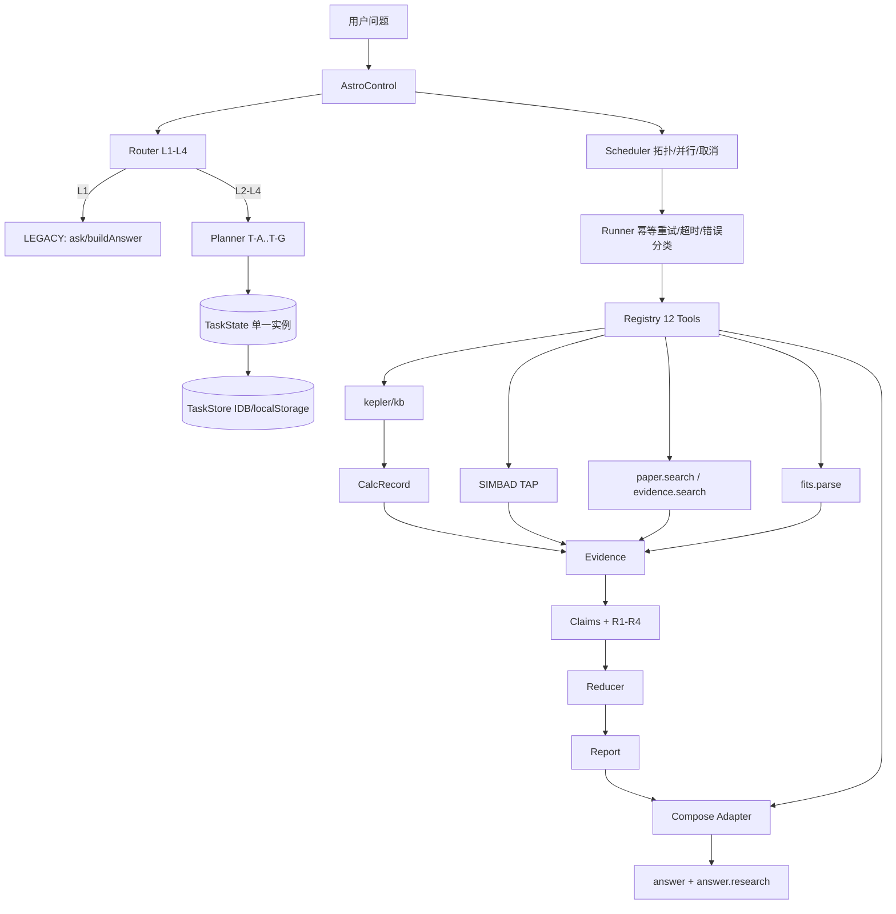

# ASTRUM V1 最终验收报告

> 日期：2026-10-31
> 范围：B + C + D 合并开发（任务书 `ASTRUM V1 核心能力建设总任务书`）
> 结论：**B/C/D 核心链路形成可运行闭环；SIMBAD 真实网络端到端因本机不可达标记 DEFERRED；其余真实论文与 FITS 链路已验证。**
> 未执行 git add / commit / push。

---

## 1. B 阶段完成情况

| 项目 | 结果 |
|---|---|
| Router 复杂度/L1-L4/原因/信号 | 完成；新增目录式别名边界（M42 不再误命中 M4） |
| Planner 七模板/校验/环/依赖 | 完成；新增解释、预算估算、步骤上限 8、有限重规划 |
| TaskState 生命周期/Event/Budget | 完成；新增统一 StepResult 字段、重试/取消/重规划事件、phaseStartedAt |
| Scheduler 拓扑/并行/失败传播 | 完成；新增取消停止、optional 依赖失败不阻塞 |
| Runner 超时/异常/重试 | 完成；错误分类、幂等声明、最多 1 次安全重试、取消 |
| Tool Registry 12 工具 | 完成；retry/idempotent/timeout/权限声明；4 个 deferred 工具真实化 |
| Compose Adapter T-A/T-C 闭环 | 保持；新增 Research 证据/报告注入，旧路径不变 |
| B 阶段测试 | control-test 21/86、b8-test 10/33、v1b-test 6/25 全绿 |

### 1.1 Router 边界

- [router.js](file:///D:/Projects/Astrum/core/router.js)：`filterTargetCollisions` 仅丢弃“完全落在更长编号内且无独立出现”的短命中。
- `M42 是什么` → 目标只有猎户座大星云；`M4 和 M42 有什么区别` → 两个目标都保留。

### 1.2 Planner

- [planner.js](file:///D:/Projects/Astrum/core/planner.js)：`buildPlan` 返回 `explanation/estimate`；`validate` 支持 `opts.budget` 与 8 步上限；`replan` 仅重组 compose/compare 依赖。
- 研究类问题优先进入 T-E/T-F；七模板数量未增加。

### 1.3 TaskState / Event

- [task.js](file:///D:/Projects/Astrum/core/task.js)：Step 增加 `toolId/durationMs/provenance/evidenceRefs/cancelled`；Event 增加 `step.retry/step.cancelled/task.cancelled/task.replanned/task.recovered`；payload 白名单增加 `attempt`。
- TaskState 仍只由 Control 创建/持有，不进入 answer。

---

## 2. C 阶段完成情况

| 能力 | 结果 |
|---|---|
| C1 统一执行结果 | StepResult 由 Runner 统一写入 ToolState；Adapter delivery 增加 `unifiedSteps` |
| C2 取消传播 | AbortSignal 贯穿 Control → Scheduler → Runner；pending→aborted；在飞请求标记 `pendingAbort`；TaskState→ABORTED |
| C3 失败恢复 | 错误分类；保留成功结果；失败依赖→blocked；不伪造成功 |
| C4 有限重规划 | 最多 1 次；仅重组 compose/curate 依赖；预算 `replans` 扣减；`task.replanned` 事件 |
| C5 Reducer | Evidence 去重（DOI/URI/内容）、镜像识别、独立来源、数值冲突、事实/推断/假设、来源保留、不改原件 |
| C6 TaskStore | IndexedDB 优先 → localStorage → 内存；save/get/list/remove/clear；schema 校验；`isResumable`；`Control.resume` |
| C7 Event | 只追加、seq 单调；重试/取消/恢复/重规划事件；不驱动执行 |

测试：`v1c-test` 6 案例 / 30 断言全绿。

### 2.1 取消示例

`Control.run(..., { signal: AbortSignal.abort() })` → `cancelled:true`、phase `ABORTED`、所有 pending 步骤 `aborted`、answer `null`。

### 2.2 重规划示例

首次 compose 注入失败 → `Planner.replan` 生成 `t3r`，仅依赖已成功的 t1/t2；t1/t2 attempt 保持 1；重规划后成功交付。

---

## 3. D 阶段完成情况

| 能力 | 结果 |
|---|---|
| D1 SIMBAD | 真实 TAP 客户端 + TAP JSON 解析 + Evidence 映射；本机网络超时，真实端到端 **DEFERRED** |
| D2 论文检索 | Registry `paper.search` 走 Sources（arXiv/OpenAlex/Semantic Scholar/Wikipedia 降级链），返回真实元数据/摘要/DOI/链接 |
| D3 FITS | 零依赖解析：多 HDU、BITPIX 8/16/32/-32/-64、BSCALE/BZERO、图像采样统计、Binary Table、常用 WCS、截断/非法/不支持类型警告；附件层完整解析 |
| D4 Evidence | 统一字段 + 来源/时间/provenance/trust；DOI 镜像去重；`abstractOnly` 明确 |
| D5 Claim | `buildClaimsFromEvidence` + `judgeAll`；不修改 judgeClaim/R1-R4 |
| D6 工具链 | `simbad.tap` / `paper.search` / `evidence.search` / `fits.parse` 全部真实实现；离线模式明确 `network:'disabled'`，不再有 deferred 伪装成功 |
| D7 流水线 | T-E：SIMBAD（可选）+ 论文 + 证据 + compose；T-F：SIMBAD（可选）+ 正/反证据；结果进入 Reducer/Claims/Report |
| D8 报告 | 结论/参数/论文/观测/计算/证据/冲突/不确定性/来源/检索时间/覆盖度/缺口/免责声明；每条结论带 evidenceRefs |

测试：`v1d-test` 7 案例 / 34 断言（真实网络）全绿；离线 31/31。

---

## 4. 最终架构与数据流

数据传递：

`Plan → Scheduler → Runner → Registry → ToolResult → StepResult → (Reducer/Claims/Report) → Adapter → answer.research → delivery`

- 成功依赖结果 `depResults` 进入 compose；失败结果不进入下游。
- Evidence 同时来自真实检索、FITS 与 CalcRecord；Reducer 去重后进入 Claims/Report。
- 旧 `ask()` 路径不经过 Control，sections 逐字节不变。

---

## 5. 真实数据源接入情况

| 数据源 | 验证结果 | 状态 |
|---|---|---|
| arXiv / OpenAlex | D5 真实论文条目（标题/DOI/链接/摘要）；E1/E4 真实报告 | DONE（REAL） |
| Semantic Scholar / Wikipedia | 代码降级链保留；未单独网络断言 | PARTIAL |
| FITS 公开样本 `btable.fits` | 8640 B，真实 2 HDU / 1 Binary Table | DONE（REAL） |
| FITS 公开样本 `test0.fits` | 真实图像 FITS，Header/维度/统计（下载偶发连接重置） | DONE（REAL，网络波动） |
| SIMBAD TAP | 本机 8s 超时；客户端/解析单元通过；E1 如实标记缺口 | DEFERRED |
| MAST | 未接入下载 | DEFERRED |

> 本机对 `simbad.u-strasbg.fr` / `simbad.cds.unistra.fr` 连续超时；未新增代理或后端，未编造任何 SIMBAD 参数。

---

## 6. 端到端任务执行结果

| 任务 | 结果 |
|---|---|
| 一：M42 基础研究 | T-E 计划；SIMBAD 超时如实在缺口/报告中标记；真实论文证据进入 `answer.research`；报告结论有 evidenceRefs |
| 二：近五年论文 | 真实论文元数据、DOI/链接、`abstractOnly`、检索时间（REAL） |
| 三：FITS 分析 | 真实 `btable.fits` 多 HDU/表；真实 `test0.fits` Header/维度/统计；`fits.parse` 工具输出 observation Evidence |
| 四：综合研究 | 真实论文 + 真实 FITS → Claims/Reducer/Report；覆盖度 `hasPapers/hasFits=true`；多结论均有引用 |
| 五：失败恢复 | 超时重试后失败、成功结果保留、依赖 blocked、空结果不生成证据、用户取消→ABORTED |

`v1-e2e-test` 5 案例 / 24 断言（真实网络）全绿；离线 10/10。

---

## 7. 科学证据验证

- SIMBAD 存在性/坐标/视差 → qualitative claim + strong semantic support；未伪造 CalcRecord。
- 论文 → qualitative claim，摘要级 support（partial/weak），`abstractOnly`。
- FITS 主数据 HDU → quantitative claim + CalcRecord + `std/sqrt(n)` uncertainty；R1-R4 可计算。
- D6 实测：5 条 Claim，PASS 4 / PARTIAL 1 / FAIL 0。
- 同 DOI 镜像只计 1 条独立来源；冲突阈值 >5% 进入 `conflicts`，不强行合并。

---

## 8. 全部测试结果

### 8.1 新增与定向

| 套件 | 案例/断言 | 结果 |
|---|---|---|
| task-test（P0-02） | 24 / 73 | 通过 |
| p0-03-test（20 问逐字节 + 契约） | 9 / 53 | 通过 |
| control-test（B 控制层） | 21 / 86 | 通过 |
| b8-test（数据闭环） | 10 / 33 | 通过 |
| v1b-test（B 完善） | 6 / 25 | 通过 |
| v1c-test（C 能力） | 6 / 30 | 通过 |
| v1d-test（D 能力，真实网络） | 7 / 34 | 通过 |
| v1d-test --offline | 7 / 31 | 通过 |
| v1-e2e-test（真实网络） | 5 / 24 | 通过 |
| v1-e2e-test --offline | 5 / 10 | 通过 |

### 8.2 原有 12 套件

逐套件运行，退出码均为 0；既有基线 366/366 未变化：

- selftest（Chrome + `file://`，CSP 违规 0）
- store-test
- skill-test
- consistency-test
- a11y-test
- rail-test
- settings-test
- ctx-isolation-test（15 intent 全覆盖）
- research-test（77/77 离线 mock）
- csptest（6/6）
- i18n-scan（界面 0 条，基线通过）
- daily-test

### 8.3 工程检查

- 20 问 sections 逐字节比较：通过（p0-03 案例 8）。
- CSP：csptest 6/6；selftest CSP 违规 0；CSP `connect-src` 已含 `simbad.u-strasbg.fr`（客户端使用该域名）。
- Chrome + `file://`（index.html 与 standalone）：selftest 通过。
- 单文件构建：45 内联脚本 / 1494 KB / 1,530,116 B；standalone 被 `.gitignore` 排除。
- 远端 GitHub Actions：未授权 push，未运行；本地等价命令已全部执行。CI 已加入 task/p0-03/control/b8/v1b/v1c/v1d(offline)。

---

## 9. 旧系统兼容情况

- `ask()`、`buildAnswer()` 核心业务、`compose*` 内部、`toSections()`、`detectIntent()` 未修改。
- T-A/T-C 的 sections 与旧 buildAnswer 逐字节一致（b8-test/v1b-test）。
- 旧 answer/sections/trace/meta 契约保留；TaskState 未进入 answer。
- 13 Agent 名册、TRACE_ORDER、Critic 五项、Qty 未变。
- 新增 Research sections 仅在 Control 的 Adapter 路径、且存在真实 Evidence 时追加；UI 使用既有 kinds。
- 重试默认收紧为“幂等工具 + timeout/network/rate_limit，最多 1 次”；未改变旧工具结果。

---

## 10. 新增与修改文件

### 10.1 新增

- `core/evidence.js`（D4 Evidence）
- `core/fits.js`（D3 FITS）
- `core/reducer.js`（C5 Reducer）
- `core/report.js`（D8 报告）
- `core/task-store.js`（C6 持久化）
- `tools/v1b-test.js`、`tools/v1c-test.js`、`tools/v1d-test.js`、`tools/v1-e2e-test.js`
- `docs/architecture/V1-00-核心能力建设总蓝图.md`
- `docs/architecture/V1-遗留问题清单.md`
- `docs/V1-最终验收报告.md`（本文件）

### 10.2 修改

- `core/router.js`、`core/planner.js`、`core/task.js`、`core/orchestrator.js`
- `core/registry.js`、`core/compose-adapter.js`、`core/control.js`
- `core/claims.js`（仅新增构建器/judgeAll）
- `core/attachments.js`（FITS 完整解析，旧字段保留）
- `core/simbad.js`（lookup 可选 signal；旧调用兼容）
- `index.html`（新增 6 个 core 脚本）
- `.github/workflows/test.yml`（新增测试步骤，不删旧步骤）
- `tools/control-test.js`（仅加载 simbad.js，断言未改）
- `core/agents.js`、`core/runtime.js`（B8 既有修改保留，本 V1 未改核心业务）

---

## 11. 尚未完成的功能与原因

| 项 | 状态 | 原因 |
|---|---|---|
| SIMBAD 真实网络端到端 | DEFERRED | 本机连接 SIMBAD TAP 连续超时；不新增后端/代理；客户端与解析已实现 |
| SIMBAD CORS 浏览器实测 | PARTIAL | 本机无法连通，未能在 Chrome 实测 |
| 真实 image FITS 下载稳定性 | PARTIAL | `test0.fits` 偶发连接重置；`btable.fits` 稳定；图像统计已用本地生成 FITS + 可达时的真实文件验证 |
| T-B/T-D 结果复用 | PARTIAL | 仍走回退；V1 优先保证 T-A/T-C/T-E/T-F |
| `ask()` 接控制层 | TODO | 保持旧 UI 兼容，未接线 |
| TaskStore IndexedDB 浏览器实测 | PARTIAL | Node 测试覆盖 localStorage 回退与恢复逻辑；IDB 代码与 store.js 同源但未在 Chrome 单独断言 |
| 论文全文 | DEFERRED | 未获取全文；所有论文 Claim 标 `abstractOnly` |
| MAST 下载 | DEFERRED | 未接入；FITS 使用公开样本 |
| 远端 CI | DEFERRED | 未授权 push |
| Research UI 展示 | PARTIAL | `answer.research` 与 sections 已生成，但 `ask()` 未接 Control，默认 UI 不展示新链路 |

---

## 12. V1 最终能力边界

**已具备**：
- L1 旧链路不变；L2-L4 可规划/调度/执行/取消/有限重规划。
- 12 工具注册与真实化检索/FITS；失败不伪造成功。
- 真实论文检索 + 真实 FITS 解析 + Evidence/Claim/Reducer/Report。
- 任务持久化（IDB/localStorage）与刷新后恢复（EXECUTE 阶段）。
- 旧系统契约与 366 断言兼容。

**尚未具备**：
- SIMBAD 真实网络数据（受环境网络限制）。
- 无后端、无数据库服务器、无外部框架；所有数据来自公开浏览器可访问端点或本地文件。
- 不声称已读论文全文，不把摘要/模型输出当作独立外部证据。
- 不把缺失/失败结果包装成事实。

---

## 13. 验收结论

> **V1.1 更新（2026-11-01）**：本报告是 V1 阶段历史结论。V1.1 已关闭 V1-L04（`ask()` 接 Control）、V1-L11（Chrome IndexedDB 验证）、V1-L13（Research UI 展示），并新增 [V1.1 实施报告](V1.1-实施报告.md) 与 [V1.1 架构更新](architecture/V1.1-架构更新.md)。仍保留的边界见 `docs/architecture/V1-遗留问题清单.md`。

- B 阶段：通过。控制层稳定，T-A/T-C 闭环未退化。
- C 阶段：通过。取消、失败恢复、安全重试、有限重规划、Reducer、持久化、Event 均有测试。
- D 阶段：**有条件通过**。论文与 FITS 真实链路通过；SIMBAD 真实网络验证因本机不可达标记 DEFERRED，未编造数据。
- 旧系统：366/366、20 问逐字节、CSP、i18n、Chrome/file:// 均通过。
- **V1 核心能力形成可运行闭环，但 SIMBAD 数据能力需在可访问网络环境复测后才能宣称完整。**

完成后停止，等待负责人审阅；未执行任何 Git 写操作。
