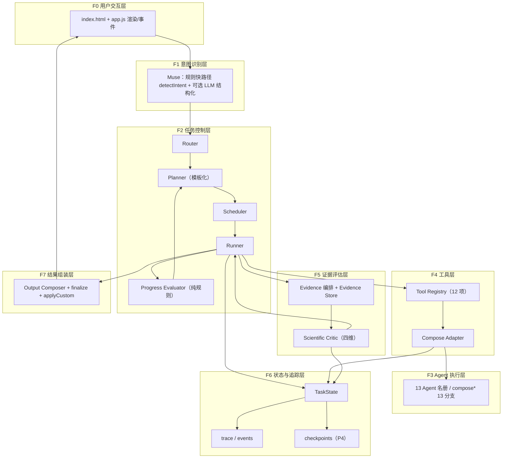
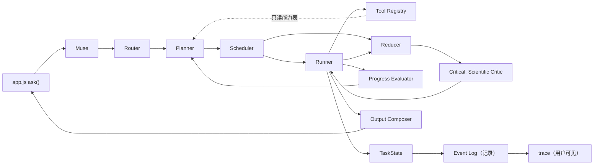
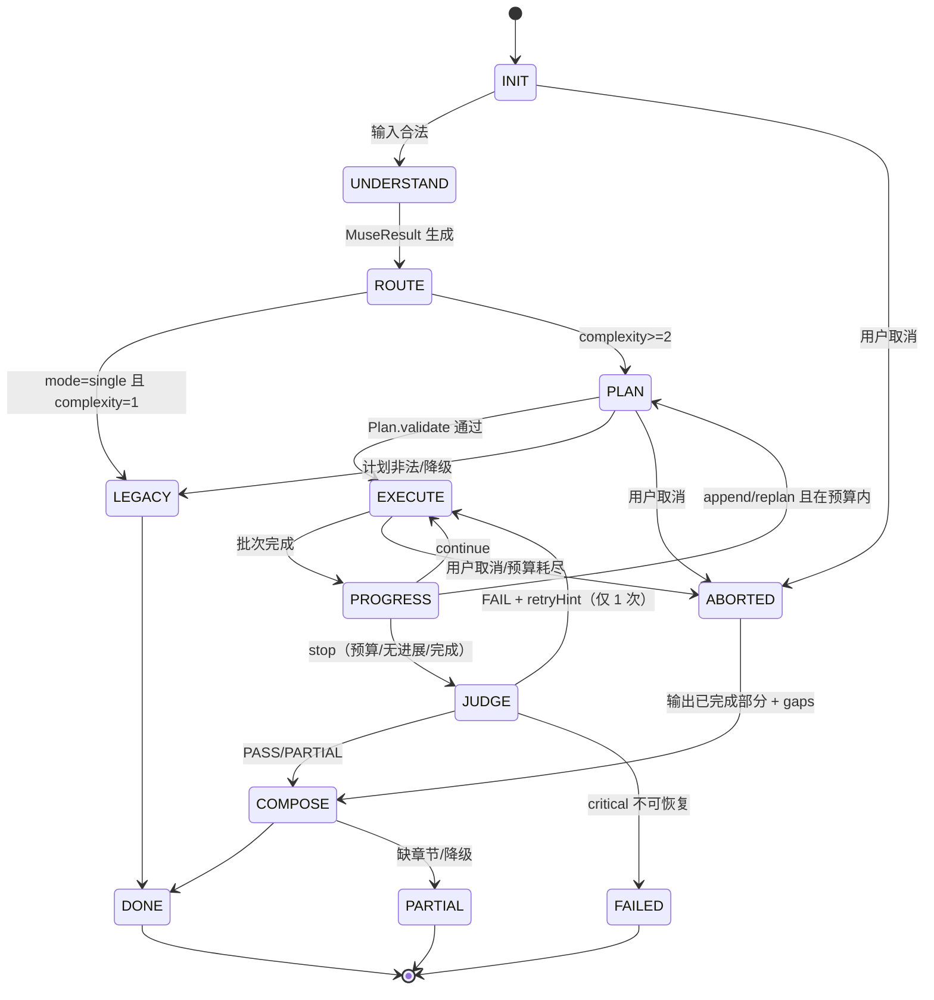
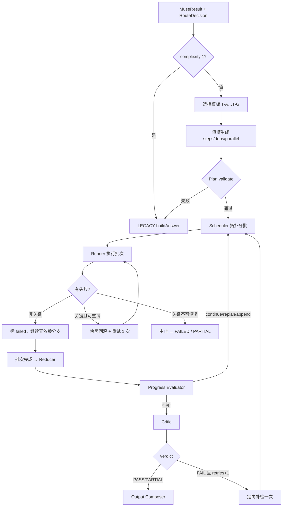
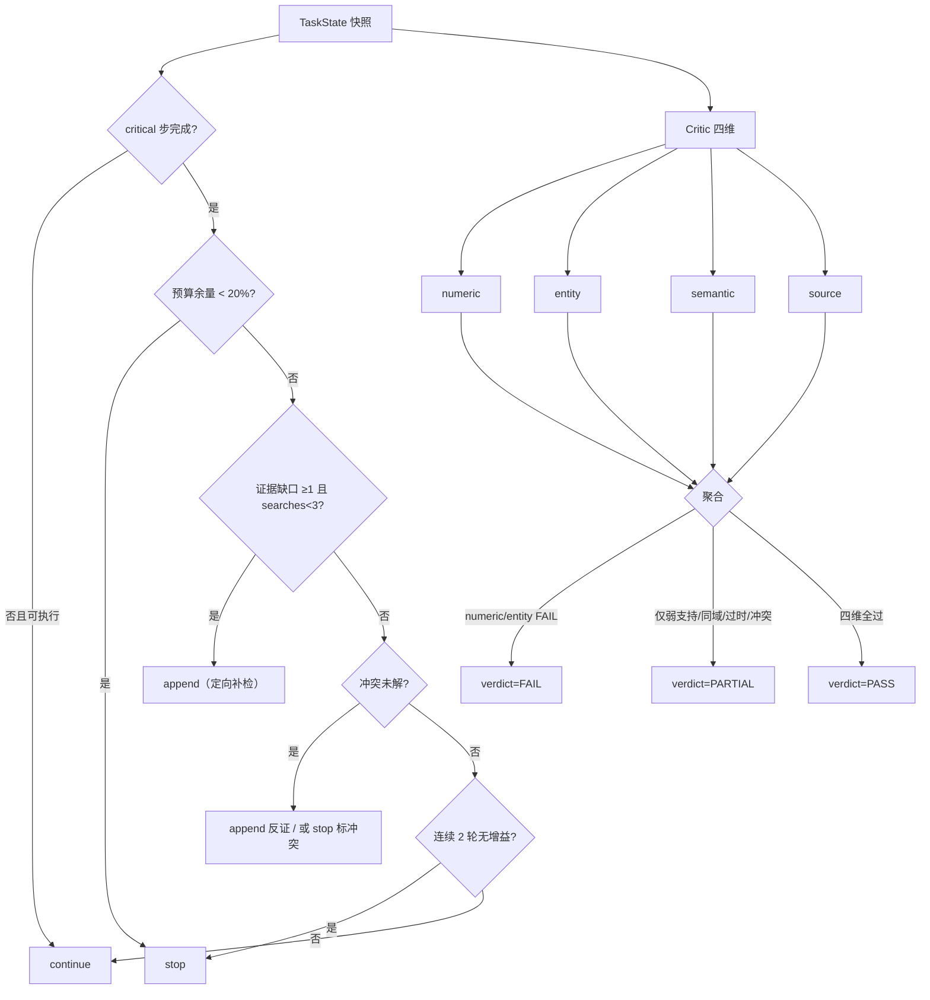
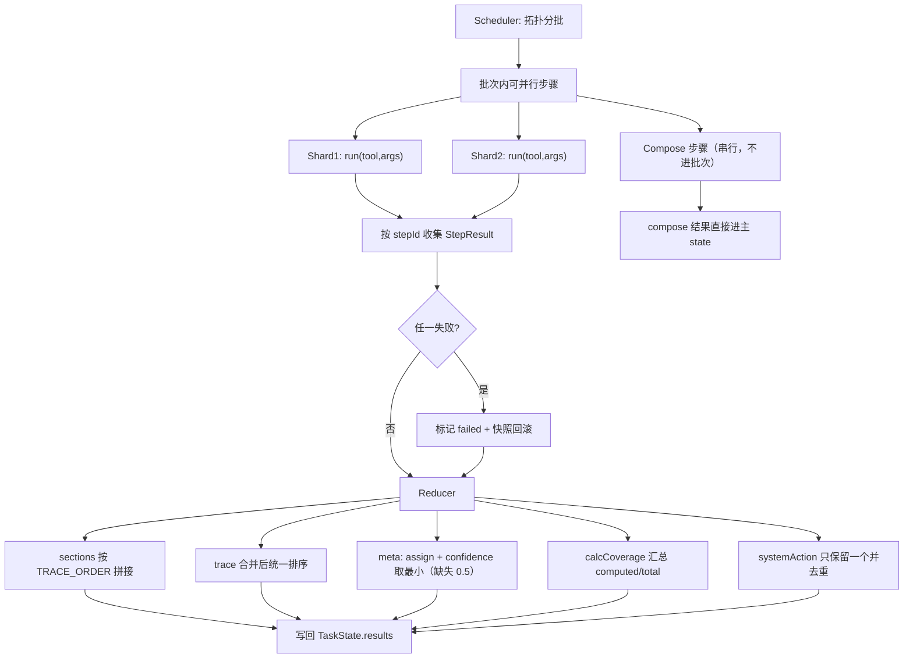
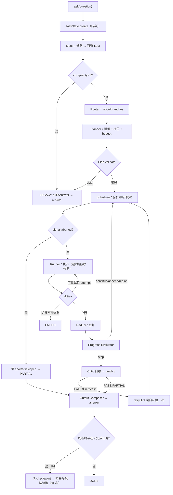

# P0-01 目标架构总蓝图

> 定位：P0 阶段的**设计总蓝图**，不是实施计划。所有代码仍按 `09` 的 P0 边界留在后续阶段。
> 输入：`15`（唯一权威契约）、`P0-00`（差距分析）、`P0-00.1`（含负责人已确认的四项裁定）、00–16 原始文档。
> 硬约束（负责人已确认）：不重建；13 Agent 不增不减；两层控制；L1 跳过 Planner；Planner 只用 7 模板；取数并行 / compose 串行；**TaskState 不挂载到 answer**；零依赖零服务端；无事件总线；无独立 Optimizer；保留 366 条断言。
> 标注约定：**〔既有〕**＝文档已有且已确认；**〔新增〕**＝本蓝图首次定义；**〔待细化〕**＝方向已定、结构留待后续阶段；**〔风险〕**＝需验证或存在冲突。

---

## 0. 设计边界

| 项 | 本次 | 后续 |
|---|---|---|
| 模块结构、状态机、接口职责、失败语义 | ✅ 定稿 | — |
| 具体实现、文件落地、测试代码 | ❌ 不做 | P0-02 / P0-03 |
| Event 结构 | ✅ 只定结构 | P2 实现；持久化顺延 P4 |
| 条件边 / 取消 / 预算 / intent 映射 | ✅ 定方向与契约 | P2/P1 前细化 |
| Optimizer | ❌ 明确不做 | — |
| 契约变化 | 仅 4 处，全部标注原因与影响（§8.9） | — |

**层命名**：为不与 `04` §2 的控制层级 L0–L4 混淆，本蓝图用 **F0–F7 功能层**；与 `04` 的对应关系写在 §1.2。

---

## 1. 整体架构

### 1.1 系统分层图〔新增（基于既有职责重排）〕



### 1.2 分层职责与与 `04` 的映射

| 功能层 | 职责 | 允许调用 | 禁止调用 | 对应 `04` §2 |
|---|---|---|---|---|
| **F0 用户交互层** | 输入、渲染、面板、toast、附件 | F1 | 直接调 F3/F4 | L0 应用层 |
| **F1 意图识别层** | 实体/时空/意图/复杂度；LLM 仅结构化 | F2（Router）、Schema 校验 | 调工具、调 compose | L1 控制层（Muse） |
| **F2 任务控制层** | 路由、规划、调度、执行、进度判定 | F4 工具、F3 经 Registry、F6 状态 | 改结果内容、写 `answer` | L1 控制层 |
| **F3 Agent 执行层** | 13 个角色的领域计算与章节产出 | F4 工具、纯函数库 | 反向调 F2、横向调其他 compose | L2 执行层 |
| **F4 工具层** | 注册、能力声明、`run(args,ctx)`、超时/降级 | 纯函数库、外部适配器 | 决定何时调用 | L2 执行层 |
| **F5 证据评估层** | 取数、证据关系、四维判定 | F4、Kepler 只读复算 | 改数据、写 verdict 以外状态 | L3 评审层 |
| **F6 状态与追踪层** | TaskState 生命周期、trace、event、checkpoint | 被 F2/F3/F5 读写 | 主动驱动执行 | 横切（15 §1） |
| **F7 结果组装层** | `sections/trace/meta` 组装、语体、自定义裁剪 | 只读 TaskState | 改数值/证据 | L4 输出层 |

### 1.3 模块依赖图〔新增〕



> 依赖方向只有一条主线：**F0→F1→F2→F4→F3/F5→F7**；F6 被读写但不发起调用。反向边（F3→F2、F3→F3 横向、F5 写 F3）一律禁止（`04` §2）。

---

## 2. 模块职责表

| 模块 | 文件（规划） | 职责 | 不负责 | 状态 |
|---|---|---|---|---|
| Muse | 扩建 `detectIntent` 外层，**不新建文件** | 实体/时空/意图/复杂度；LLM 只做结构化 | 路由、规划 | 〔既有〕`03` §3.1 + 〔新〕LLM 层归 P1 |
| Router | 逻辑内聚在 `buildAnswer` 分派段升级 | 决定模式（single/compare/research）与分支集合 | 执行、规划 | 〔既有〕`03` §3.2 |
| Planner | `core/planner.js` | 选模板、填槽、依赖图、预算申请 | 执行、决定停止、设预算 | 〔既有〕`03` §3.3 / `05` §2 |
| Scheduler | 并入 `core/orchestrator.js`（约 90 行） | 拓扑排序、并行批次、就绪判定 | 执行 | 〔既有〕`03` §3.4 R2-05 |
| Runner | 同上（约 110 行） | 单步执行、超时、重试、分片、回滚、取消检查 | 合并 | 〔既有〕+〔新〕取消协议（§6.4） |
| Reducer | `core/reducer.js`（约 70 行） | 分片合并（sections/trace/meta） | 执行 | 〔既有〕`15` §6 |
| Progress Evaluator | `core/evaluator.js` | 完成度/缺口/预算 → continue/append/replan/stop | 改结果、调 LLM | 〔既有〕`03` §3.5 / `05` §5 |
| Tool Registry | `core/registry.js` | 注册/查询能力表 | 执行、合并 | 〔既有〕`15` §7 |
| Compose Adapter | `core/registry.js` 内工厂 | `run(args,ctx)` → `{sections,trace,meta}` | 决定调用时机 | 〔既有〕`12` §5 |
| Evidence Store | 扩 `research.js` 的 item | 证据、关系、时间线 | 判定 | 〔既有〕`03` §3.8 / `06` §2.2 |
| Scientific Critic | 扩 `criticReview` | 四维判定 + verdict | 改数据、改写答案 | 〔既有〕`15` §5 |
| TaskState | `core/task.js` | 结构、校验、序列化 | 写盘（P4） | 〔既有〕`15` §1.1 / §2 |
| Output Composer | 复用 `finalize` + 新组装段 | 组章节、排序、语体 | 改事实 | 〔既有〕`03` §3.11 |
| Event Log | 并入 `core/task.js` | 只追加事件记录 | 订阅/派发/重放 | 〔新增〕§7 |

**没有新增第 14 个 Agent**；控制层组件不进入 `AGENTS` 名册（`04` §6）。

---

## 3. 任务生命周期

### 3.1 状态机〔既有 phase 枚举 + 新增 FAILED〕



### 3.2 状态表（进入/退出/异常）

| 状态 | 进入条件 | 退出动作 | 允许转移 | 异常处理 |
|---|---|---|---|---|
| INIT | `ask()` 创建 TaskState | 校验 question/ctx/attachments | UNDERSTAND / ABORTED | 输入非法 → 直接结束（不建任务） |
| UNDERSTAND | 输入合法 | 产出 `MuseResult`（15 标签 + complexity 1–4） | ROUTE | LLM 失败 → 回退规则（`03` §3.1） |
| ROUTE | 有 MuseResult | 产出 `RouteDecision{mode,branches}` | LEGACY / PLAN | 无匹配 → single + 单分支 |
| PLAN | complexity≥2 | `Plan.validate` 通过并写入 `budget` | EXECUTE / LEGACY / ABORTED | 环/越权/超预算 → 降级单步；连续 2 次失败 → LEGACY |
| EXECUTE | 有合法 Plan | 按批次执行，写 `steps[].status` | PROGRESS / ABORTED | 单步失败按 §6.3 |
| PROGRESS | 一批完成 | 产出 `ProgressDecision` | EXECUTE / PLAN / JUDGE | 判定异常 → 保守 stop（`03` §3.5） |
| JUDGE | 停止执行 | 产出 `EvalResult` | COMPOSE / EXECUTE（一次）/ FAILED | LLM 不可用 → 只跑规则，verdict 上限 PARTIAL |
| COMPOSE | 有评审结论 | 组装 `answer`（不进 TaskState） | DONE / PARTIAL | 缺章节 → PARTIAL 标记 |
| DONE | 组装完成 | 记录结束事件 | — | — |
| PARTIAL | 组装完成但有缺口 | 附 gaps 文案 | — | — |
| FAILED 〔新增〕 | critical 步骤不可恢复失败，或评审 FAIL 且无重试余量 | 输出失败原因 + 已完成章节 | — | 不得伪造答案 |
| ABORTED | 用户取消 / 预算耗尽 | 标记在途步骤，保留已完成 | COMPOSE | 不得「后台继续」 |

> **契约影响（E4）**：`15` §2.1 的 Phase 枚举需增补 `FAILED`（原枚举只有 DONE/ABORTED/PARTIAL），并在 §2 的合法转移表中登记；`Step.status` 需增补 `aborted`。两条都是**追加枚举值**，不影响既有字段（§8.9）。

### 3.3 生命周期关键规则

1. **一个 ask 一个 TaskState**；P0 只在内存，P2 同；P4 才写 `store.putTask`（`15` §2）。
2. **TaskState 不挂载到 `answer`**（负责人约束）：`answer` 仍是 `{query,intent,ctx,targets,trace,sections,meta}`；TaskState 由调用方持有并在 `ask()` 作用域内传递。
3. **LEGACY 是合法终态路径**：L1 与降级计划都走 `buildAnswer`，不产生 TaskState 以外的行为变化（`09` 行为零变化）。
4. **恢复**：P4 从最后一个 checkpoint 续跑；恢复次数 ≤1；检索不幂等必须重跑（`15` §4.1–§4.2）。

### 3.4 状态隔离与合法/非法转移

**隔离关系（E4 的核心）**

| 新状态 | 只存在于 | 是否进入 `answer` | 对旧渲染器的影响 |
|---|---|---|---|
| `Phase.FAILED` | `TaskState.phase` | ❌（TaskState 不挂载到 answer） | 无：渲染器只读 `answer.sections/meta` |
| `Step.status='aborted'` | `TaskState.steps[]` | ❌ | 无（不进 sections） |
| 事件 `task.aborted` | `TaskState.events[]` | ❌ | 无 |

因此 E4 是**纯追加枚举值**：旧渲染路径看不到这两个值；若未来要把失败态展现给用户，只能通过 F0 的错误 UI，不得塞进 `sections`（避免改变 answer 契约）。

**合法转移（唯一权威；与 §3.1 图一致）**

| From | 允许的 To |
|---|---|
| INIT | UNDERSTAND、ABORTED |
| UNDERSTAND | ROUTE |
| ROUTE | LEGACY、PLAN |
| LEGACY | DONE |
| PLAN | EXECUTE、LEGACY、ABORTED |
| EXECUTE | PROGRESS、ABORTED |
| PROGRESS | EXECUTE、PLAN、JUDGE |
| JUDGE | COMPOSE、EXECUTE（仅 retryHint 且 retries<1）、FAILED |
| COMPOSE | DONE、PARTIAL |
| ABORTED | COMPOSE |
| DONE / PARTIAL / FAILED | 无（终态） |

**非法转移（必须由 `assertValidTransition()` 拒绝，并抛结构化错误）**

1. `DONE/PARTIAL/FAILED → 任意状态`（终态不可复活）
2. `LEGACY → PLAN/EXECUTE/JUDGE`（legacy 不再进入编排）
3. `PROGRESS → COMPOSE`（跳过评审）
4. `JUDGE → PLAN`（重规划必须经 EXECUTE，不得绕回 Planner）
5. `ABORTED → EXECUTE/PLAN`（取消后不得重启执行）
6. `INIT → PLAN/EXECUTE`（必须先 UNDERSTAND/ROUTE）
7. `EXECUTE → DONE`（不得跳过 PROGRESS/JUDGE）
8. `JUDGE → EXECUTE` 当 `retries≥1`（补检只允许一次）

**测试要求（进 P0-02 的 `task-test`）**：对上述 8 类非法转移至少各 1 条负向断言（共 ≥8 条），每条断言 `assertValidTransition` 抛错且错误信息含 `from/to/reason`；合法转移另用 20 条正向用例覆盖（见 §15.1 第 10 项）。

---

## 4. 动态编排

### 4.1 协作关系（不含 Optimizer）

| 角色 | 输入 | 输出 | 权限 | 状态 |
|---|---|---|---|---|
| Planner | MuseResult + RouteDecision + Registry 能力表 | `Plan` | 只读能力表；不设预算、不决定停止 | 〔既有〕`03` §3.3 |
| Executor（Scheduler+Runner） | Plan + TaskState | 更新 `steps/results/budget.used` | 调工具；重试 1 次；取消检查 | 〔既有〕`03` §3.4 |
| Evaluator（Progress） | TaskState | `{action,gaps,reason}` | 只读 | 〔既有〕`05` §5 |
| Critic | TaskState（claims/evidence/calc） | `EvalResult` | 只读 Evidence、只读复算 | 〔既有〕`15` §5 |
| Optimizer | — | — | **不存在**（负责人 O1） | 〔负责人确认〕 |

**O1 落地方式**：`EvalResult.retryHint` 是唯一的「优化」入口，只允许触发一次定向补检/重算（`retries≤1`），不设改写回路，不改 `sections` 文本。

### 4.2 Planner 模板选择〔既有模板 + 新增判定顺序〕

| 步骤 | 判定 | 选择 |
|---|---|---|
| 1 | `detectIntent` 命中单一 intent 且 complexity=1 | 不规划，LEGACY |
| 2 | intent ∈ {target, knowledge-target, observe-target, intro-target} | T-A |
| 3 | intent=tonight | T-B |
| 4 | observe/photo + 机制/为什么 | T-C |
| 5 | compare 模式或多目标 | T-D |
| 6 | 论文/最新进展/研究 | T-E（L4）或 T-F（争议） |
| 7 | system-view | T-G |
| 8 | 无匹配 | 单步 Plan（等价 LEGACY 包裹） |

> 模板来源 `05` §2；「判定顺序」是〔新增〕，用于消除「一个问句命中多个模板」的歧义（按上表自上而下，先命中先选）。

### 4.3 Planner → Executor 执行流程〔新增图示〕



### 4.4 Evaluator 与 Critic 的评估流程〔新增图示〕



### 4.5 何时重新规划 / 何时停止 / 如何防循环

| 动作 | 触发（可在原文找到） | 次数上限 | 预算 |
|---|---|---|---|
| continue | critical 未完成且有可执行步（`05` §5） | 受步数上限 | 正常消耗 |
| append | 证据缺口≥1 / 来源单一 / 冲突未解，且 searches<3（`05` §5） | 3（`05` §4） | 计入 searches |
| replan | 计划不可执行（工具失败/依赖断裂）（`05` §5.1） | 2（`05` §4） | 不额外批 |
| Research Loop | 新实体/一手源争议/前提未验证（`05` §5.1） | 2 轮，预算 ≤初始 50% | 需申请 |
| stop | 全部 critical 完成 / 预算耗尽 / MAX_REPLAN / 用户中止 / 连续 2 轮无增益（`05` §6） | — | — |
| Critic 补检 | FAIL 且有 retryHint（`06` §4.2） | 1（`05` §4 retries≤1） | 计入预算 |

**防无限循环四道闸**：`MAX_REPLAN=2`、`append≤3`、`retries≤1`、单调性（每次 replan/Loop 必须有新增步骤/证据/消除冲突/缩小 gap，连续 2 次无改善强制 stop，`05` §5.1 R2-04）。

---

## 5. 工具系统

### 5.1 ToolSpec〔既有 + 新增 deps〕

```js
ToolSpec = {
  id, version,                       // 'kepler.ephemeris', '1.0.0'
  caps: ['compute'|'search'|'llm'|'local'|'compose'],
  argsSchema, returns,               // 轻量 JSON Schema 子集
  timeoutMs, cost: { ms, tokens, searches },
  permissions: { canProduceNumbers },
  idempotent: boolean,
  ttlMs: number | null,
  deps: string[]                     // 〔新增 E3〕依赖的模块/全局对象名
}
```

**E3 原因**：`12` §2.2（R4-05）明确 `composeGearFit` 需 `GEAR/FIT/OBSPLAN`、`composeSystemView` 需 `solarsystem`；`15` §7.1 表未列 `deps`，按需加载会漏（测试已暴露过 `GEAR is not defined`）。影响：`Plan.validate` 增加「工具依赖已加载」检查；不改变任何现有字段。

### 5.2 12 项工具基线（`15` §7.1，不扩张）

| id | caps | idempotent | ttl | deps（新增列） |
|---|---|---|---|---|
| `kepler.ephemeris` | compute | ✅ | ∞ | `astro` |
| `kepler.visibility` | compute | ✅ | ∞ | `astro` |
| `kb.lookup` | local | ✅ | ∞ | `knowledge`, `catalog` |
| `evidence.search` | search | ❌ | 0 | `research`, `sources` |
| `simbad.tap` | search | ✅ | 7d | `simbad` |
| `paper.search` | search | ❌ | 0 | `sources` |
| `llm.compose` | llm | ❌ | 0 | `sources` |
| `fits.parse` | local | ✅ | ∞ | `attachments` |
| `compare.curate` | local | ✅ | ∞ | `agents`(curate) |
| `compose.target` | compose | ✅ | ∞ | `agents`, `astro`, `knowledge`, `catalog` |
| `compose.domain` | compose | ✅ | ∞ | `agents`, `astro`, `knowledge`, `catalog`, `gear`, `fit`, `obsplan`, `solarsystem` |
| `compose.simple` | compose | ✅ | ∞ | `agents`, `astro`, `catalog`, `solarsystem` |

### 5.3 注册、发现、调用、错误与超时

| 环节 | 规则 | 依据 |
|---|---|---|
| 注册 | 启动时一次性注册；`id` 唯一；缺 `argsSchema`/`timeoutMs`/`caps` 直接抛错（启动即失败，不做运行期兜底） | `07` §4.2；〔新增〕 |
| 发现 | Planner 只读 `{id,caps,argsSchema,cost,deps}`，不可读 `run` | `03` §3.3 权限 |
| 调用 | 统一 `run(args, ctx) → Promise<RawResult>`；纯计算工具可同步返回，Runner 用 `Promise.resolve` 包裹 | `12` §5 |
| 超时 | 每次调用 `timeoutMs`；超时即 `step.failed(reason:'timeout')`，可重试 | `04` §3.2；`07` §4.4 |
| 失败 | 返回 `{ok:false, reason, retriable}`，不抛到 F0 | `07` §4.4 |
| 校验 | 入参先过 `validate(args, argsSchema)`；不通过 → 计划校验阶段拒绝 | `07` §4.2 |

---

## 6. 并行执行

### 6.0 执行边界：P0 不变、分片延期

| 项 | P0 阶段 | P2+（延期设计） |
|---|---|---|
| 修改 `compose*` | ❌ 一行不改（K5 裁定；`16` §1） | 仅包 adapter，函数体仍不改（`12` §5） |
| 并行 `compose*` | ❌ 禁止；P0 只有 LEGACY 串行路径 | 仍禁止直接并行；只能在分片内执行（`12` §4.4） |
| `newShard` / Reducer | ❌ **不实现**，本蓝图只保留契约文本 | P2 实现，必须双层拷贝 + 冻结（`05` §3.1 R4-02） |
| 副作用顺序 | 保持现状（串行写入顺序即执行顺序） | 分片内保持执行顺序；跨分片由 Reducer 按 TRACE_ORDER 统一 |
| 结果语义 | 与 `buildAnswer` 完全等价 | 分片合并后 `sections` 内容与串行等价，仅顺序由 TRACE_ORDER 决定 |

**结论**：`compose*` 的副作用顺序与结果语义在任何阶段都不得改变；分片是**后续阶段的隔离手段**，不是 P0 的执行方式。

### 6.1 分片与隔离〔既有 R4-02；延期设计，P2 启用〕

```js
newShard(base) = {
  query, intent,                     // 只读
  ctx: Object.freeze(Object.assign({}, base.ctx,
        { cityRef: Object.freeze(Object.assign({}, base.ctx.cityRef || {})) })),
  targets: base.targets,             // 只读共享
  trace: [], sections: [], meta: {}  // 每分片新建
}
```

- `compose*` 有 155 处原地写，**只能串行**或跑在分片里（`12` §4.4）；
- `caps:'compose'` 不得与任何步骤同批并行（`15` §7.1）；
- 取数工具（kepler/kb/evidence/paper）可并行，并发 `min(4, 剩余预算/单步预算)`（`05` §3）。

### 6.2 执行与合并流程〔新增图示〕



### 6.3 失败 / 重试 / 取消语义

| 情形 | 处理 | 状态标记 | 依据 |
|---|---|---|---|
| 单步超时 | 按 `retriable:true` 重试 1 次；仍失败标 `failed` | `failed` | `04` §3.2；`05` §4 |
| 单步异常 | 快照（`sections.length/trace.length/meta`）→ 截断 → 重试或标 failed | `failed` | `12` §4.5 |
| 关键步骤失败 | 中止，进入 JUDGE，输出 PARTIAL 或 FAILED | `blocked` / `FAILED` | `03` §3.4 |
| 非关键失败 | 继续无依赖分支 | `failed`，不影响其他 | `03` §3.4 |
| 用户取消 | 批次边界检查 `signal.aborted`；已 ok 保留、running→`aborted`、未开始→`skipped:cancel` | `ABORTED` | 〔新增 G3〕`05` §6 |
| compose 抛错 | 截断回快照；`systemAction` 不重复执行 | `failed` | `12` §4.5、§2.1 |
| 预算耗尽 | 不启动新步骤，标 `skipped:budget` | `PARTIAL` | `05` §6 |

> **取消不做抢占**：compose 同步、无中断点（`12` §4.6）；只有网络/模型工具响应 `AbortSignal`。

### 6.4 与 `12` 的一致性

- 并行仅在取数层、compose 串行或分片——一致（`12` §4.4）；
- 重试回滚用长度快照——一致（`12` §4.5）；
- 分片 `ctx` 双层拷贝——一致（`14` C13 实测）。

---

## 7. 事件与追踪

### 7.1 Event 结构〔新增；负责人确认只做记录〕

```js
Event = {
  seq: number,                 // 任务内单调递增
  at: ISO8601,
  taskId: string,
  type: 'phase.changed'|'step.started'|'step.ok'|'step.failed'
      |'step.skipped'|'progress.decided'|'verdict.issued'|'task.aborted',
  stepId: string | null,
  payload: object              // 只存最小上下文（from/to、action、verdict、reason）
}
```

**明确不做**：事件总线、订阅/发布、事件驱动执行、事件重放、独立事件存储（负责人确认）。Event 只由 TaskState 追加，执行仍由 `switch(phase)` 驱动。

### 7.2 Event / trace / checkpoint 的区别

| 维度 | `Event`〔新增〕 | `trace[]`〔既有〕 | `Checkpoint`〔既有〕 |
|---|---|---|---|
| 面向 | 机器/调试 | 用户可见叙事 | 恢复 |
| 内容 | 状态变化与步骤结果（枚举化） | `{agent,action,detail,ms}` 文本 | `{at,phase,stepId,inputHash,stateHash,budgetUsed}` |
| 数量 | 每步 1–2 条 | 每个 agent step 一条 | 每 critical 步 / PROGRESS 后一条 |
| 生命周期 | P2 内存；P4 是否落盘待定 | 随 `answer` 输出 | P4 落盘 |
| 是否驱动流程 | ❌ 不驱动 | ❌ 不驱动 | ❌ 只用于恢复 |

### 7.3 写入时机

| 时机 | Event | trace | checkpoint |
|---|---|---|---|
| phase 变化 | `phase.changed{from,to}` | — | — |
| 步骤开始/结果 | `step.started` / `step.ok` / `step.failed` / `step.skipped` | 由 compose/tool 产出 | 仅 critical 完成后（P4） |
| 进度决策 | `progress.decided{action}` | — | ✅（P4） |
| 评审结论 | `verdict.issued{verdict}` | critic 的 step | — |
| 取消/中止 | `task.aborted{reason}` | — | — |

---

## 8. 数据契约

> 基准：`15` 为唯一权威。以下只列本蓝图需要固定或新增的部分；**未列字段完全沿用 15**。

### 8.1 TaskState〔沿用 15 §1.1 + E4〕

新增两个枚举值（`phase` 增 `FAILED`、`Step.status` 增 `aborted`），其余字段与 5 条不变量不变。`events: Event[]` 为〔新增〕可选字段（缺省空数组）。

### 8.2 Claim〔沿用 15 §1.3〕

`id/text/type/entities/numbers/premises/support[{eid,strength,basis}]/contradict[]/uncertainty/source/calc/required/origin`。**不含 `confidence`**（K10 裁定）。

### 8.3 EvidenceItem〔沿用 15 §1.4〕

含 `tier/kind/title/excerpt/publishedAt/retrievedAt/lang/independentOf/conflictsWith/trust{whitelisted,hasAuthor,hasDate,doiValid,score}`。

### 8.4 CalcRecord〔沿用 06 §5.1〕

`value/unit/epoch/frame/source/method/inputs/uncertainty/computedAt`；缺 `epoch/frame/inputs` 任一 → numeric FAIL。

### 8.5 EvalResult〔沿用 15 §1.5〕

`verdict/dimensions{numeric,entity,semantic,source}/checks[{name,ok,source,detail}]/gaps/retryHint/llmNote`；`llmNote` 不参与 verdict。

### 8.6 Budget〔新增权威定义 E2〕

```js
Budget = {
  level: 'L1'|'L2'|'L3'|'L4',
  limit: { ms, tokens, llmCalls, searches, parallel, replans, appends, retries },
  used:  { ms, tokens, llmCalls, searches, parallel, replans, appends, retries }
}
```

**合并依据**：`04` §5 提供配额全集（llm 3 / searches 3 / parallel 4 / replans 2 / appends 3 / retries 1 / 总超时 45s・research 120s），`05` §6 提供分档 ms 与 tokens；`15` §8 只定义 Token 采集方式。**唯一权威落在 15**（后续增补），`04`/`05` 保留论证但改为指针。详见 §9。

### 8.7 ToolSpec〔沿用 15 §7.1 + deps〕

见 §5.1；`deps` 是唯一新增字段（E3）。

### 8.8 Reducer 输入输出〔沿用 15 §6〕

输入 `ShardResult[]`（每片 `{stepId, sections, trace, meta}`）；输出 `{sections, trace, meta}`，规则：sections 按 TRACE_ORDER、trace 合并排序、`meta.confidence` 取最小（缺失 0.5）、`calcCoverage{computed,total}`、`systemAction` 去重、`meta.review` 各维度取最差。

### 8.9 契约变化清单（必须显式登记）

| 编号 | 变化 | 原因 | 影响 | 状态 |
|---|---|---|---|---|
| E1 | 新增 `Event` 结构与 8 类型；`TaskState.events[]` 可选 | 负责人确认的轻量事件记录 | 只增字段；不驱动执行 | 〔新增〕 |
| E2 | 新增 Budget 权威契约（字段并集 + L1–L4 分档） | 消除 `04` §5 与 `05` §6 两套上限 | TaskState.budget 形状固定；`used≤limit` 不变量沿用 | 〔新增〕 |
| E3 | `ToolSpec.deps: string[]` | R4-05 已要求但 15 未落表 | `Plan.validate` 增加依赖已加载检查 | 〔新增〕 |
| E4 | `Phase` 增 `FAILED`；`Step.status` 增 `aborted` | 负责人要求完整失败/中止语义 | 枚举扩展；旧渲染器忽略未知值 | 〔新增，需 15 增补〕 |
| — | `Claim` 去掉 `confidence`、加 `basis`；`EvidenceItem` 加 `trust` | K10 裁定，以 15 为准 | 06 需回填 | 〔既有裁定〕 |

---

## 9. 复杂度与预算

### 9.1 复杂度统一为 1–4〔K3 裁定〕

| 级别 | 判定（`05` §1 规则） | 策略 | Planner | 目标延迟 |
|---|---|---|---|---|
| L1 / complexity=1 | 单实体 + 单意图，无复合连词 | LEGACY，不建 Plan | 跳过 | <300ms |
| L2 / 2 | 2 个无依赖子任务，或计算+解释 | 2 步并行 | T-A/T-C | <3s |
| L3 / 3 | ≥3 子任务，或对比/综合/为什么+怎么 | 模板拆解 + 并行 | T-D/T-E 部分 | <15s（单模式 ≤45s） |
| L4 / 4 | 显式研究/综述/争议 | research 模式 + 证据链 + 评审回退 | T-E/T-F | <120s |

### 9.2 唯一预算表〔E2〕

| 项 | L1 | L2 | L3 | L4 |
|---|---|---|---|---|
| `ms` | 300 | 3 000 | 15 000 | 120 000 |
| `tokens` | 0 | 1 200 | 3 000 | 8 000 |
| `llmCalls` | 0 | 1 | 2 | 3 |
| `searches` | 0 | 1 | 2 | 3 |
| `parallel` | 1 | 2 | 4 | 4 |
| `replans` | 0 | 1 | 2 | 2 |
| `appends` | 0 | 1 | 3 | 3 |
| `retries`（单步） | 0 | 1 | 1 | 1 |
| ask 级硬上限 | 300ms | 45s（single/compare） | 45s | 120s（research） |

规则：每步执行前 `reserve(step)`、执行后 `settle(actual)`；超预算的步骤不启动，标 `skipped:budget`；`used ≤ limit` 恒成立（`15` §1.1 不变量 5）。`04` §5 的 45s 与 `05` §6 的 L3 15s **不是冲突**：15s 是计划预算，45s 是 ask 级硬上限。

---

## 10. 现有系统映射

### 10.1 intent ↔ Schema kind ↔ compose ↔ 工具

| # | intent 标签〔代码 15〕 | Schema kind〔07 的 12〕 | compose 分支〔13〕 | 工具组合 |
|---|---|---|---|---|
| 1 | smalltalk | **规则专属（LLM 不可产出）** | `composeSmalltalk` | `compose.simple` |
| 2 | tonight | tonight | `composeTonight` | T-B；`compose.simple` |
| 3 | cosmos | cosmos | `composeCosmos` | `compose.domain` |
| 4 | nova | nova | `composeNova` | `compose.domain` |
| 5 | helios | helios | `composeHelios` | `compose.domain` |
| 6 | event | event | `composeEvent` | `compose.simple` |
| 7 | system-view | system-view | `composeSystemView` | `compose.simple` |
| 8 | chart | chart | `composeChart` | `compose.simple` |
| 9 | gear | gear | `composeGear` | `compose.simple` |
| 10 | gear-fit | gear-fit | `composeGearFit` | `compose.domain` |
| 11 | photo-target | photo | `composePhoto` | `compose.domain` |
| 12 | observe-target | target | `composeTarget` | `compose.target` |
| 13 | knowledge-target | target | `composeTarget` | `compose.target` |
| 14 | intro-target | target | `composeTarget` | `compose.target` |
| 15 | unknown | **规则专属（LLM 不可产出）** | `composeFallback` | `compose.simple` |

### 10.2 13 个 Agent 的去向〔保留〕

| Agent | 架构位置 | 变化 |
|---|---|---|
| muse | F1 意图识别 | 扩 LLM 层（P1），规则保留快路径 |
| kepler | F4 工具（数值权威） | 注册为 `kepler.*`，不改计算 |
| curator | F5 证据合并 | 注册 `compare.curate` |
| critic | F5 评审 | 扩四维（P0 加字段） |
| vega/orion/lyra/navigator/scholar | F3 展示/知识 | 不改，trace 标 `presentational` |
| cosmos/nova/helios/horizon | F3 领域 | 包 adapter，不改函数体 |

### 10.3 保留 / 升级 / 新增 / 延后

| 类别 | 内容 | 依据 |
|---|---|---|
| **保留** | `astro`、`runtime`（TIER/Qty）、`research` 两轮、`simbad`、`store`、`thread`、`profile`、CSP、13 Agent 名册 | `08` §1 |
| **升级** | `detectIntent`（外层）、分派段（Router）、`criticReview`（四维）、`Qty`（epoch/frame/inputs）、`TYPE_WEIGHT`→tier、`ask`（开关分派） | `08` §2 |
| **新增** | `task.js`、`schema.js`、`claims.js`（P0）；`registry.js`、`planner.js`、`orchestrator.js`、`evaluator.js`、`reducer.js`、`delegation.js`、`search-pipeline.js`（P2+） | `08` §3；`09` |
| **延后** | Event 持久化（P4）、条件边与取消实现（P2）、budget 落地（P2）、intent 映射落地（P1）、Controlled Delegation（P2.5 可选） | 本蓝图 §14 |
| **不做** | Optimizer 改写回路、事件总线、框架、服务端、物理拆文件 | 负责人 + `00` §明确不做 |

---

## 11. 完整执行流程（含异常/重试/取消/恢复）〔新增图示〕



### 11.1 失败语义总表

| 失败点 | 处理 | 终态 | 依据 |
|---|---|---|---|
| Muse LLM 失败 | 回退规则 | 继续 | `03` §3.1 |
| Plan 非法 | 降级单步（LEGACY） | DONE | `03` §3.3 |
| 单步超时/异常 | 快照回滚 + 重试 1 次 | 继续或 `failed` | `12` §4.5 |
| critical 失败 | 中止并评审 | PARTIAL / FAILED | `03` §3.4 |
| 预算耗尽 | 停新步，标 skipped | PARTIAL | `05` §6 |
| 用户取消 | 批次边界生效 | ABORTED→PARTIAL | 〔新增〕 |
| Critic FAIL | 一次定向补检 | 仍 FAIL → FAILED | `06` §4.2 |
| 恢复失败 | 提示重新提问 | FAILED | `15` §4.2 |

---

## 12. 设计决策与依据

### 12.1 已有且确认的设计〔既有〕

| 决策 | 来源 |
|---|---|
| 只加控制层、不重建；两层控制 | `03` §1；`P0-00.1` K1–K11 |
| L1 跳过 Planner；7 个模板；三不许 | `05` §1–§2；`03` §3.3 |
| 取数并行、compose 串行/分片 | `05` §3.1；`12` §4.4 |
| 四维 Critic、数字匹配只能 weak、无 HEAD 探测 | `15` §5；`06` §4.3 |
| Reducer 纯函数、confidence 最小、calcCoverage | `15` §6 |
| 恢复三策略 + ≤1 次；P0 不写盘 | `15` §2、§4 |
| 12 工具；caps:compose 不并行 | `15` §7.1 |
| legacy 开关、断言只增不减 | `07` §5；`09`；`10` §5 |

### 12.2 本次新增的设计〔新增〕

| 决策 | 理由 |
|---|---|
| F0–F7 功能层命名（避免与 L0–L4 混淆） | 分层需 8 个功能面，但控制层级仍是 5 级 |
| `FAILED` 终态与 `Step.status=aborted` | 负责人要求完整失败/中止语义 |
| Event 记录（8 类、只追加、不驱动） | 负责人确认；替代「事件总线」的高成本方案 |
| Budget 唯一契约与 L1–L4 分档 | 消除 04/05 两套上限 |
| ToolSpec.deps | R4-05 要求未落表 |
| Planner 模板判定顺序（§4.2 自上而下） | 消除多模板命中歧义 |
| L3 15s 计划预算 vs 45s ask 硬上限 | 把两处数字解释为不同层级而非冲突 |
| Optimizer 不存在，retryHint 单次补检 | 负责人 O1 |

### 12.3 尚待后续阶段细化〔待细化〕

| 项 | 阶段 |
|---|---|
| Event 持久化策略（是否随 checkpoint 落盘） | P4 前 |
| 条件边 `Edge` 的具体校验实现 | P2 前 |
| 取消在 Runner 内的检查粒度（每步/每批） | P2 前 |
| intent 映射落进 Schema 与 Router | P1 前 |
| G8 fixture 六条样例的字段值 | P0-02（结构已在 §15.1 冻结） |
| 恢复的 `stateHash` 计算方式（canonicalJSON 规则） | P4 前 |

### 12.4 风险与待验证〔风险〕

| 风险 | 说明 | 缓解 |
|---|---|---|
| R1 预算分档与真实延迟不符 | 15s/45s 是设计值，未压测（V4） | P2 前用 20 目标压测 |
| R2 事件追加带来的内存增长 | 长任务事件可达数百条 | 只存最小 payload；P2 限制 500 条环形 |
| R3 `FAILED` 枚举对旧渲染器 | 渲染器只认 DONE/PARTIAL | 未知 phase 不渲染，走通用错误态 |
| R4 工具 deps 与脚本加载顺序耦合 | 新模块需打进 `index.html` 顺序 | `Plan.validate` 检查 + 启动自检 |
| R5 Critic 语义维度能力边界 | 规则无法判断物理正确性 | 保留「依据+边界」措辞，不因 PASS 宣称正确（`16` §6） |

---

## 13. 与现有 17 篇文档的一致性检查

| 文档 | 本蓝图是否冲突 | 说明 |
|---|---|---|
| 00 | ❌ 无 | 遵守「不重建/不引框架/明确不做」 |
| 01 | ❌ 无 | 15 intent/13 compose/13 Agent 与代码一致；352→366 已登记 |
| 02 | ❌ 无 | 三个核心问题（无状态/Critic 只查结构/单分支）分别由 TaskState/四维/多分支承接 |
| 03 | ⚠️ 一处口径修正 | `complexity:1..5` 改 1–4（K3）；Optimizer 按 O1 不做（负责人） |
| 04 | ⚠️ 一处口径收敛 | §5 配额并入 Budget 契约（E2），原文保留论证 |
| 05 | ❌ 无冲突 | 模板/并行/Progress/停止条件全部沿用；R3-01 阶段分工一致 |
| 06 | ⚠️ 字段以 15 为准 | Claim 去 `confidence`、support 加 `basis`、Evidence 加 `trust`（K10） |
| 07 | ⚠️ 补映射说明 | 12 kind 不含 smalltalk/unknown，需注明规则专属；零依赖不变 |
| 08 | ❌ 无 | 保留/升级/新增/延后与 §10.3 一致；无删除 |
| 09 | ⚠️ 两处回填 | P0 步骤 5 exec 顺延 P2（K5）；回滚 3 文件（K7）；P0 断言口径（K6） |
| 10 | ⚠️ 一处门槛调整 | P0 验收改结构+fixture，T1/T2 移 P1（K11，负责人确认） |
| 11 | ⚠️ 一处回填 | 「检查点阻塞 P0」已被 15 §2 覆盖（K8） |
| 12 | ⚠️ 一处措辞回填 | §8 结论 2 的「05 主张并行 compose」已撤回（K2）；B2 部分解除（K9） |
| 13 | ❌ 无 | R2 修订全部继承 |
| 14 | ⚠️ 状态回填 | V2 与 B2 统一为「部分解除」（K9） |
| 15 | ⚠️ 四处增补 | Event/Budget/FAILED/aborted/deps 需写入 15（§8.9） |
| 16 | ⚠️ 两处回填 | ALIAS 行撤回（K1）；P0 断言 ~20 口径（K6） |

> 结论：**没有推翻任何已确认决策**；冲突均为「旧文未回填」或「契约需增补」，且全部在 `P0-00.1` 有裁定记录。

---

## 14. 尚未解决的问题（分级）

| # | 问题 | 分级 | 说明 |
|---|---|---|---|
| 1 | Event 是否持久化、存多少 | **后续阶段（P4 前）** | 负责人已授权顺延；P0 只定结构 |
| 2 | 条件边 `Edge.when` 的合法字段白名单 | **后续阶段（P2 前）** | P0 不实现编排，无阻塞 |
| 3 | 取消检查粒度与 `aborted` 对 checkpoint 的影响 | **后续阶段（P2 前）** | 与取消实现同批 |
| 4 | Budget 分档是否按 provider 调整 tokens 估算 | **后续阶段（P2 前）** | 契约已定，估算策略待定（`15` §8） |
| 5 | intent 反向映射（target→3 类细分）归属 Router 还是 Muse | **后续阶段（P1 前）** | 映射表已定（§10.1），归属待定 |
| 6 | `FAILED` 是否触发「建议重新提问」产品文案 | **后续阶段（P0-03 联调）** | 不影响 P0-02；且不得写入 sections |
| 7 | V1 / V3 / V4 / V5 | **需进一步确认指代** | 文档中确有此编号（`14` §6、`15` §10），但本轮不展开；若负责人另有指代，以其口径为准 |

> 原「P0 实施前必须明确」的两项（G8 fixture 清单、P0-02 测试清单）已在 §15.1/§15.2 冻结，不再是遗留项。

---

## 15. 后续工作划分与正式实施边界

| 阶段 | 范围 | 产出 | 验收 |
|---|---|---|---|
| **P0-02** | 纯函数层：`task.js`、`schema.js`、`claims.js` + 6 条 fixture + `task-test` | 代码 + 测试 | 366 全绿 + 新增全绿（清单见 §15.1）；fixture 判定正确；不接 `sections` |
| **P0-03** | 既有文件字段扩展：`criticReview`、`Qty` + 20 问逐字节对照 | 代码 + 基线报告 | 见 §15.3；sections 零 diff；CI 全绿 |
| P1 | Muse LLM 层 + intent 映射 + T1/T2 端到端 | 设计→实现 | 简单问零模型调用 |
| P2 | Planner/Registry/Scheduler/Runner/Reducer + 条件边/取消/预算 | 设计→实现 | L1 不回归；compose 串行 |
| P3/P4 | 证据专业化 / research 模式与恢复 | 设计→实现 | 按 `09` 验收 |

### 15.1 P0-02 测试清单（24 例，约 30 条断言；全部运行时执行，不以静态检查代替）

**A. TaskState 结构、不变量与状态机（12 例）**

| # | 用例 | 场景 | 预期 |
|---|---|---|---|
| 1 | `create()` 默认值 | 空输入创建 | 必填字段齐全；`phase='INIT'`；`events=[]`；`schemaVersion=1` |
| 2 | 序列化往返 | `create→toJSON→fromJSON` | 深比较相等；无函数/循环引用 |
| 3 | 不变量 1 正例 | step `ok` 且写 `outputHash` | 校验通过 |
| 4 | 不变量 1 反例 | step `ok` 但 `outputHash=null` | `validate()` 抛错，含字段路径 |
| 5 | 不变量 2 正例 | `source='kepler'` + `quantitative` + 合法 `CalcRecord` | 通过 |
| 6 | 不变量 2 反例 | 同上但 `calc=null` | 抛错；错误码 `E_CLAIM_CALC_REQUIRED` |
| 7 | 不变量 3 负向 | 定量 claim 无 `calc`，跑四维 numeric | numeric 不得 PASS（至少 PARTIAL） |
| 8 | 不变量 4 正/反 | `eval!=null` 有/无 `required:true` | 有则通过，无则抛错 |
| 9 | 不变量 5 | `used ≤ limit`；构造 `used>limit` | 前者通过，后者抛错 |
| 10 | 合法转移 | 20 个合法 from→to（§3.4 表全量） | `assertValidTransition` 全部返回 true |
| 11 | 非法转移 | 8 类（§3.4 清单），参数化 | 每条抛错，错误含 `from/to/reason`（8 条子断言） |
| 12 | `events` 追加 | 连续 append 8 类事件 | `seq` 从 1 单调递增；payload 只含白名单键 |

**B. Schema 校验器（2 例）**

| # | 用例 | 场景 | 预期 |
|---|---|---|---|
| 13 | 正例 | `type/required/properties/items/enum/min/max` 全部命中 | `{ok:true, errors:[]}` |
| 14 | 负例 | 缺 required、数值越界、非法 enum、类型错 | `ok:false`；`errors[]` 每项带 `path` 与 `reason` |

**C. Claim 结构与 6 条 fixture（7 例）**

| # | fixture | 构造要点 | 预期 |
|---|---|---|---|
| 15 | **C1** | 定量 + `source='kepler'` + 完整 `CalcRecord`（epoch/frame/inputs/uncertainty）+ strong semantic support | `PASS`；验证 numeric 与不变量 2 |
| 16 | **C2** | 定性 + strong **semantic** support | `PASS`；语义维度基线 |
| 17 | **C3** | 定量 + support 全为 `basis:'numeric'` | `PARTIAL`；验证「数字匹配 ≠ 证据支持」 |
| 18 | **C4** | 定量但缺 `uncertainty` | `FAIL`；触发 R4 |
| 19 | **C5** | `contradict` 非空且 `uncertainty.kind!=='model'` | `PARTIAL`；触发 R3，且要求展示双方 |
| 20 | **C6** | support 全 `weak`，claim 措辞含「已证实」 | `FAIL`；触发 R2 |
| 21 | R1 派生用例 | 取 C2，令其 `premises` 指向一条判定失败的 claim | 最高 `PARTIAL`；触发 R1（不新增 fixture） |

> 6 条 fixture 的字段值由 P0-02 在 `claims.js` 内以 `FIXTURE` 导出；每条只断言 `{verdict, rule}` 两个值，避免把文案写进断言。R1 用 C2 的派生副本，保持 fixture 总数仍为 6。

**D. Qty 兼容（2 例）**

| # | 用例 | 场景 | 预期 |
|---|---|---|---|
| 22 | 缺新字段 | 仅旧字段 `value/unit` | `legacy:true`；不抛错；`value/unit` 原值不变 |
| 23 | 全字段 | 带 `epoch/frame/inputs/uncertainty` | 无 `legacy` 标记；旧字段逐字段等于构造值 |

**E. 模块可用性（1 例）**

| # | 用例 | 场景 | 预期 |
|---|---|---|---|
| 24 | Node 可用 | `require('core/claims.js')` 等三模块 | 无 `window` 依赖；单全局出口；`task-test` 可在纯 Node 跑 |

**测试约束**：原有 366 条不得减少、不得修改预期值；新增用例必须能在无网络环境运行；P0-02 结束时 `node tools/task-test.js` 与既有 12 套件同时全绿。

### 15.2 P0-03 兼容性要求（逐条可验证）

| # | 要求 | 验证方式 |
|---|---|---|
| 1 | `criticReview` 旧 5 项**名称、顺序、判定结果**不变 | 用 3 个既有答案快照对比 `checks[]`（深比较） |
| 2 | 新字段只追加：`verdict`/`dimensions`/`gaps`，不重命名、不删除旧字段 | 结构断言 + 旧调用方读取路径测试 |
| 3 | 新四维**不得覆盖**旧检查结果 | `checks[]` 保持原值；四维结论只写入 `dimensions` |
| 4 | 新字段缺失时旧行为不变 | 构造只含旧字段的 `eval`，断言渲染与判定不抛错 |
| 5 | `Qty` 新字段不改变旧计算 | 同输入下 `value/unit` 与旧实现逐字段一致；缺字段标 `legacy:true` |
| 6 | 20 问 `sections` 逐字节一致 | canonicalJSON（键序固定）后字符串比较；0 字节差异 |
| 7 | 新增断言（P0-03 部分，≥5 条）全绿 | 5 条用例：旧 checks 快照、缺字段兼容、verdict 聚合、Qty legacy、20 问 diff |
| 8 | CI 20 步全绿、`i18n-scan --max=0` 不变 | Actions 实跑 |

### 15.3 P0-02 / P0-03 的正式边界

| 允许 | 禁止 |
|---|---|
| 新增 `task.js`/`schema.js`/`claims.js` 与 `tools/task-test.js` | 改 `compose*`、改 `toSections`、接真实 Claim 生成 |
| 给 `criticReview`/`Qty` **追加字段** | 改旧字段语义、改旧检查顺序、改渲染契约 |
| 调整 `index.html` 脚本加载顺序（新增 3 个 script） | 新增依赖、改 CI、改既有断言 |
| 生成对照报告（`dev/` 下，已 gitignore） | 把 TaskState 挂到 `answer`、写盘/`putTask` |

> 本蓝图**不启动**任何代码实施；P0-02 需人工批准后另行开始。
