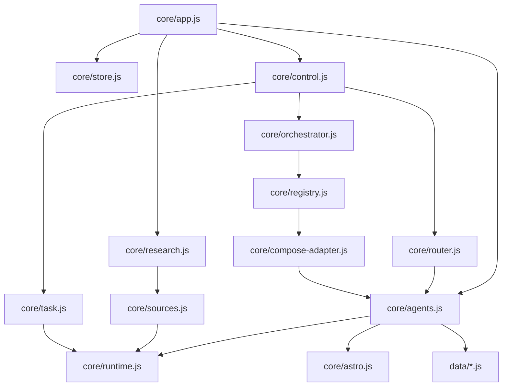
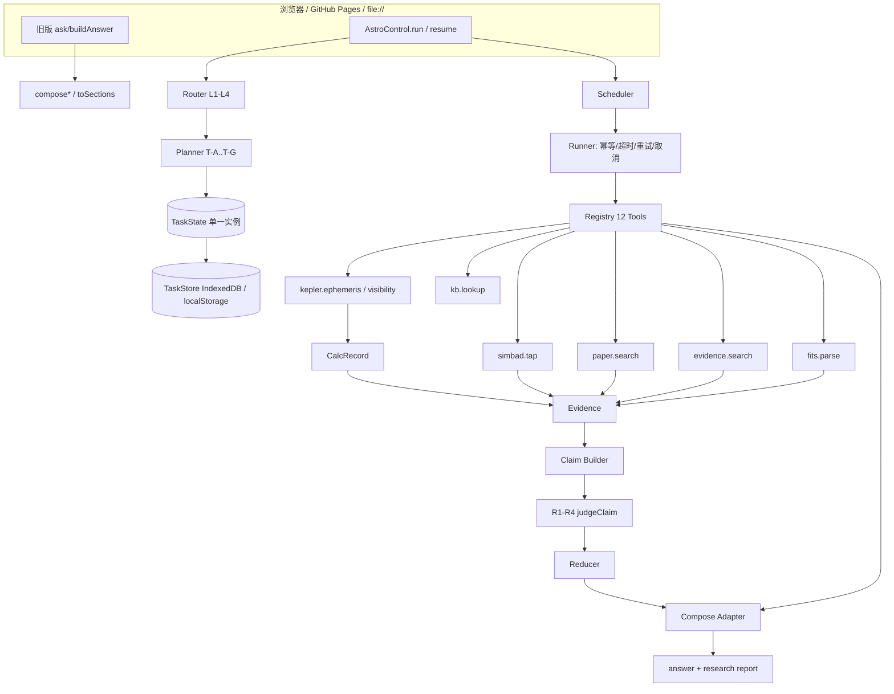
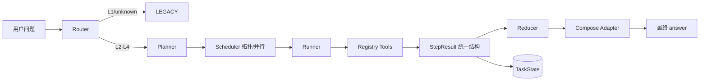
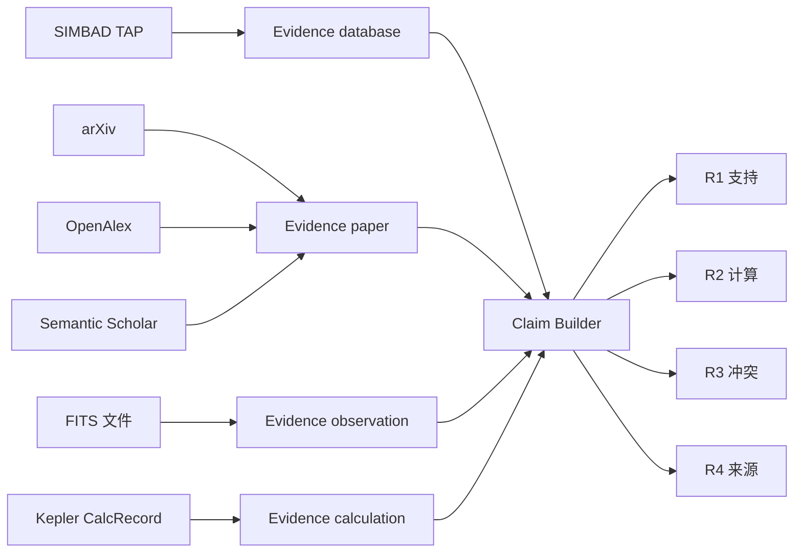
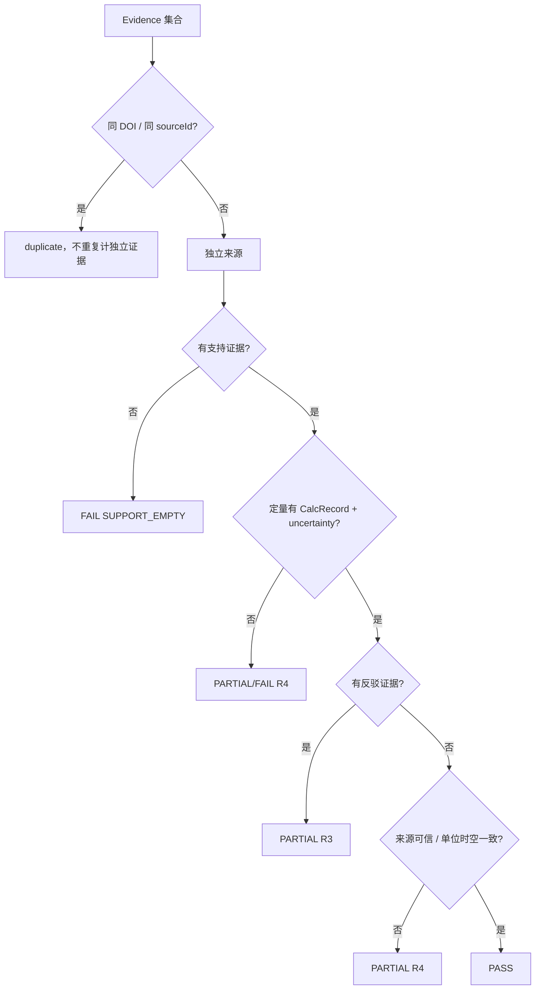
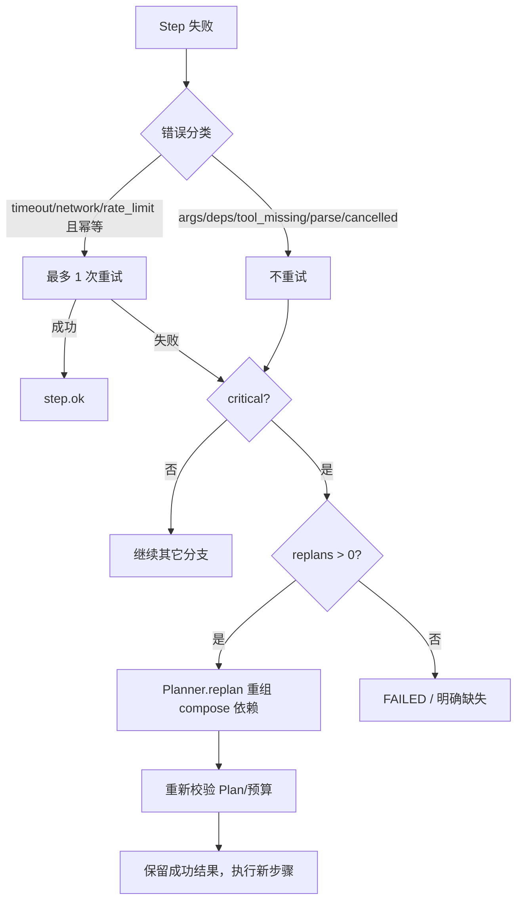
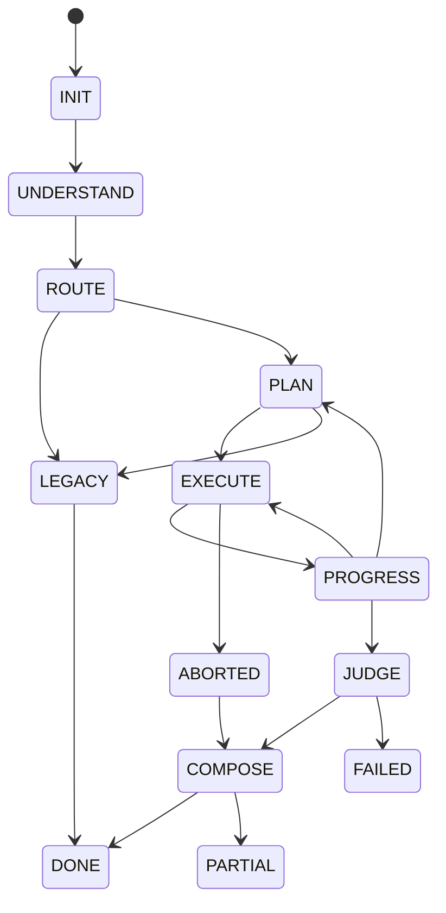

# ASTRUM V1 核心能力建设总蓝图

> 版本：V1-00
> 日期：2026-10-31
> 依据：`# ASTRUM V1 核心能力建设总任务书`（B+C+D 合并开发计划）
> 适用边界：纯静态 JavaScript、浏览器 / GitHub Pages / `file://`、零外部运行时依赖。
> 说明：本文只描述**已核实代码**与 V1 目标，不把设计当成已实现能力。

---

## 1. 当前架构现状

```
index.html
├─ data/*.js                星表 / 知识库 / 地点 / 天体 / 器材
├─ core/runtime.js          四档应答、Exec、Qty 契约
├─ core/task.js             TaskState / Phase / Step / Event / Budget（P0-02）
├─ core/schema.js           JSON Schema 最小校验
├─ core/claims.js           Claim / Evidence 关联 / R1–R4
├─ core/agents.js           13 Agent + Muse + buildAnswer（旧业务核心）
├─ core/sources.js          多端点检索（arXiv/OpenAlex/S2/Wikipedia/NASA）
├─ core/research.js         多轮检索、去重、排序、冲突、synthesis
├─ core/simbad.js           SIMBAD TAP 客户端（真实实现，独立入口）
├─ core/attachments.js      FITS 头解析（仅前 28800 B）
├─ core/router.js           B1 路由
├─ core/planner.js          B2 七模板
├─ core/registry.js         B6 12 工具
├─ core/compose-adapter.js  B7/B8 数据闭环
├─ core/orchestrator.js     B4/B5 Scheduler + Runner
├─ core/control.js          B1/B3/B4/B5 控制入口
└─ core/app.js              UI 装配（ask 仍在旧链路）
```

### 1.1 模块依赖（当前）



### 1.2 当前数据流（只读核对）

- `AstroControl.prepare`：`resolveTargets → detectIntent → Router.route → TaskState.create → Planner.plan`。
- `AstroControl.run`：`Orchestrator.runPlan` 按依赖分批；`Runner.executeOne` 调用 `Registry.get(tool).run`；结果写回 `state.steps[i].result`。
- compose 步骤：`Registry.runCompose → ComposeAdapter.compose → buildPreloaded(depResults) → AgentCore.buildAnswer(query,ctx,cfg,preloaded)`。
- T-A/T-C 已实现 targets/ephem 复用；T-B/T-D 仍回退旧计算；T-E/T-F 的证据工具是 deferred。
- TaskState 不进入 `answer/sections/trace/meta`；`ask()` 尚未接控制层。

---

## 2. V1 目标架构



### 2.1 Agent 任务执行流程



### 2.2 Research 数据流



### 2.3 Claim / Evidence 验证



### 2.4 失败恢复与有限重规划



### 2.5 TaskState 生命周期



---

## 3. B / C / D 功能清单与状态

状态口径：DONE=代码+测试证明；PARTIAL=部分实现；DEFERRED=接口/占位，真实能力延期；TODO=未实现。

| 阶段 | 功能 | 状态（V1 前） | V1 目标 |
|---|---|---|---|
| B1 | Router 复杂度 / L1-L4 / 原因 | DONE | + 目标边界消歧、signals |
| B2 | Planner 七模板 / 校验 / 环检测 | DONE | + 解释、预算估算、有限重规划 |
| B3 | TaskState Phase/Step/Event/Budget | DONE | + 耗时、统一结果字段、新事件 |
| B4 | Scheduler 拓扑 / 并行 / 失败传播 | DONE | + 取消停止 |
| B5 | Runner 超时 / 异常 | PARTIAL | + attempt/错误分类/幂等重试 |
| B6 | Registry 12 工具 | PARTIAL | + 真实 4 工具、重试/幂等声明 |
| B7 | Compose Adapter T-A/T-C 闭环 | DONE | + Research 证据/报告注入 |
| C1 | 统一执行结果 | PARTIAL | StepResult 扩展 |
| C2 | 取消传播 | TODO | AbortSignal 全链路 |
| C3 | 失败恢复 | TODO | 分类/安全重试/保留成功 |
| C4 | 动态重规划 | TODO | 最多 2 次（L3/L4；L2=1）、仅 compose 依赖重组（ADR-001） |
| C5 | Reducer | TODO | 去重/冲突/来源/事实-推断-假设 |
| C6 | TaskState 持久化 | TODO | IndexedDB + localStorage 回退 |
| C7 | Event 管理 | PARTIAL | 重试/取消/重规划事件 |
| D1 | SIMBAD | DEFERRED | 真实客户端；本机网络验证 DEFERRED |
| D2 | 论文检索 | PARTIAL | 工具化 arXiv/OpenAlex/S2 |
| D3 | FITS 多 HDU/统计 | PARTIAL | 零依赖完整解析 |
| D4 | Evidence | PARTIAL | 构建器 + 来源追溯 |
| D5 | Claim R1-R4 | PARTIAL | 真实 Evidence → Claim |
| D6 | Research 工具链 | DEFERRED | 4 工具真实化/明确 unsupported |
| D7 | Research 流水线 | PARTIAL | T-E/T-F 真实数据 + 报告 |
| D8 | 研究报告 | TODO | 结构化报告 + sections |

---

## 4. 模块数据传递关系

| 生产者 | 数据 | 消费者 |
|---|---|---|
| Router | `{intent,mode,complexity,level,targets,legacy,reason,signals}` | Planner / Control |
| Planner | `Plan{template,steps,explanation,estimate}` | TaskState / Scheduler |
| Scheduler | `batch{steps,parallel}` | Runner |
| Runner | `StepResult{status,result,error,attempt,durationMs,provenance,evidenceRefs}` | TaskState / Reducer / Adapter |
| Registry | `ToolResult{ok,items|records|answer,evidenceIds,provenance}` | Runner |
| Evidence | `Evidence{evidenceId,sourceId,...}` | Claim / Reducer / Report |
| Claims | `Claim + verdict{R1-R4}` | Reducer / Report |
| Reducer | `{evidence,facts,inferences,conflicts,...}` | Adapter / Report |
| Adapter | `delivery{usedStepIds,research}` + `answer.research` | Control / UI |
| TaskStore | 序列化 TaskState | Control.resume / 历史视图 |

### 4.1 核心数据结构

**StepResult（统一）**
```text
stepId, toolId, status, output, error{kind,message,retriable},
attempt, startedAt, finishedAt, durationMs, evidenceRefs[], provenance
```

**Evidence**
```text
evidenceId, sourceId, sourceType(database|paper|encyclopedia|observation|calculation),
title, uri, retrievedAt, publishedAt, content, claimRefs[], trust{level,score,basis}, provenance
```

**Report**
```text
reportId, question, subject, conclusions[], parameters[], papers[], observations[],
calculations[], evidence[], conflicts[], uncertainties[], sources[], retrievedAt,
coverage{hasSimbad,hasPapers,hasFits}, gaps[], disclaimer
```

**TaskStore record**
```text
{id, question, phase, createdAt, updatedAt, template, resumable, viewOnly, state(JSON)}
```

---

## 5. 真实天文数据源规划

| 数据源 | 端点 | 浏览器可行性 | 计划 |
|---|---|---|---|
| SIMBAD TAP | `simbad.u-strasbg.fr` / `simbad.cds.unistra.fr` | 本机连接超时；CORS 需实测 | 真实客户端 + 解析；网络验证 DEFERRED，不新增后端 |
| arXiv API | `export.arxiv.org/api/query` | HTTP 200 | 论文检索真实接入 |
| OpenAlex | `api.openalex.org/works` | HTTP 200，真实标题 | 论文检索主端点 |
| Semantic Scholar | `api.semanticscholar.org` | 已有端点，匿名限流 | 降级端点 |
| 维基百科 | `api.wikimedia.org` / MediaWiki | 已有端点 | 百科证据 |
| FITS 公开样本 | `raw.githubusercontent.com/astropy/.../btable.fits` | HTTP 200，8640 B | 真实多 HDU/二进表解析 |
| MAST | `mast.stsci.edu` | invoke 500（空请求预期） | 仅记录，不依赖下载 |

约束：所有数据带 `retrievedAt`、`uri`、`provenance`；查询不到不编造；论文只有摘要时标 `abstractOnly`。

---

## 6. 失败恢复机制

1. 错误分类：`args_invalid / deps_missing / tool_missing / timeout / network / rate_limit / parse / data_source / cancelled / budget / empty`。
2. 自动重试仅限：工具声明 `idempotent` 且 `retry.allowed`，错误为 timeout/network/rate_limit，最多 1 次。
3. 非幂等工具默认 0 次重试。
4. 依赖失败 → `blocked`，不影响其他独立分支。
5. 关键步骤失败且尚有 replan 预算 → `Planner.replan` 仅重组 compose 依赖；保留成功结果；最多 1 次。
6. 取消 → 停止新步骤、pending→aborted、在飞请求标记 `pendingAbort`、TaskState→ABORTED、不生成正常成功答案。
7. 最终报告必须说明缺失数据与不确定性。

---

## 7. 测试策略

| 层级 | 内容 |
|---|---|
| 单元 | task / planner / router / reducer / evidence / fits / claims / store |
| 控制层 | control-test 21/86；v1b 路由/预算/重试/取消 |
| 数据闭环 | b8-test 10/33；T-A/T-C sections 逐字节 |
| C 能力 | v1c 取消/恢复/重规划/Reducer/持久化 |
| D 能力 | v1d Evidence/FITS/论文真实检索/报告 |
| 端到端 | v1-e2e 五个任务（真实网络项标注 REAL / SKIPPED） |
| 旧系统 | 12 套件 366；p0-03 9/53（20 问逐字节）；selftest/Chrome/file:// |
| 工程 | CSP、i18n-scan、store/skill/consistency/a11y/rail/settings/ctx/research |

---

## 8. 实施顺序

1. 基线快照 → 本蓝图 + 遗留清单。
2. B1 Router 边界 → B2 Planner 解释/预算/重规划 → B3/C1/C7 TaskState → B4/C2 Runner/Scheduler → B6 Registry → B7 Adapter → Control。
3. C1 Reducer → C6 TaskStore → 取消/恢复测试。
4. D4 Evidence → D3 FITS → D6 真实工具 → D5 Claims → D8 Report → 工程接入。
5. 端到端五任务 → CI 纳入 → 全量回归 → 最终验收报告。

每阶段只运行定向测试；最终统一全量回归，不做多轮重复审计。

---

## 9. 验收标准

- 原有 366 / 73 / 53 / 86 / 33 断言全绿；20 问 sections 逐字节一致。
- V1 新增 v1b/v1c/v1d 全绿；真实网络项有 REAL 或 SKIPPED(network) 证据。
- T-E/T-F 使用真实论文/证据结果；报告每条结论有 `evidenceRefs`。
- 取消、失败恢复、有限重规划、Reducer、持久化均有测试。
- CSP、i18n-scan、Chrome、file://、单文件构建通过。
- 旧 `ask/buildAnswer/compose*/toSections/detectIntent` 未改。
- DEFERRED/PARTIAL 在遗留清单与最终报告中明确列出。

---

## 10. 风险与兼容性边界

| 风险 | 边界处理 |
|---|---|
| SIMBAD 网络不可达/CORS | 真实实现；网络验证 DEFERRED；不新增代理/后端；不伪造 |
| 旧 sections 变化 | 只通过 Control 传 preloaded；p0-03 逐字节回归 |
| Research sections 影响 UI | 只用既有 kinds；`answer.research` 为附加字段 |
| 重试改变旧行为 | 只收紧非幂等工具；保留 timeout/异常断言 |
| TaskStore file:// 无 IDB | localStorage 回退 |
| 重规划死循环 | 最多 2 次（L3/L4；L2=1）+ budget.replans（ADR-001） |
| 网络测试波动 | `--offline`；CI 不依赖外网 |
| CSP 新域名 | 实测；若拦截记录 DEFERRED，不擅自削弱策略 |
| 构建产物 | 重新 build-standalone，不 commit |

---

## 11. 明确不做

- 不改 `ask()`、`buildAnswer()` 核心业务、`compose*` 内部、`toSections()`、`detectIntent()`。
- 不新增第 8 个模板、不引入外部框架/事件总线/Python 后端。
- 不改变 13 Agent 名册、旧 answer/sections/trace/meta、TRACE_ORDER、Critic 五项、Qty。
- 不做 P4 持久化服务器、多用户、云同步；不执行 git 操作。
