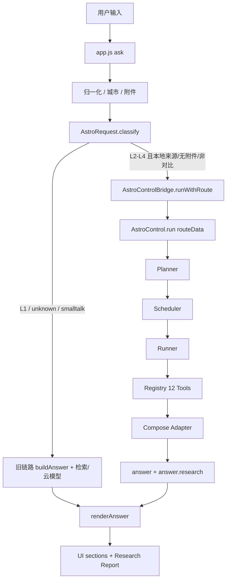
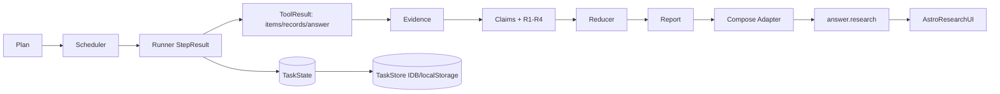
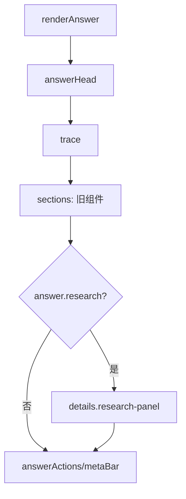
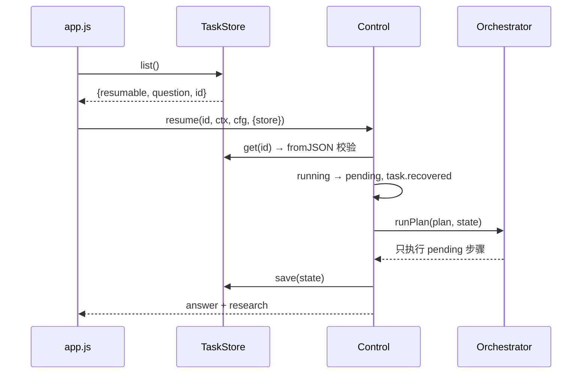

# ASTRUM V1.1 架构更新

> 日期：2026-11-01
> 范围：统一请求入口 / Research UI / TaskStore 恢复 / 兼容边界
> 原则：复用 V1 的 B/C/D 能力，不重写旧业务。

---

## 1. 新旧链路关系



关键点：
- `AstroRequest.classify` 只执行一次 Router；
- `Control.prepare` 接收 `opts.routeData`，不重复 `resolveTargets/detectIntent/route`；
- L1 仍调用旧 `buildAnswer`，旧 sections/trace/meta 契约不变；
- 新链路结果经 `renderAnswer` 与旧 UI 组件统一渲染。

---

## 2. 统一入口接口

### `AstroRequest.classify(query, ctx, cfg)`

```text
{
  query, intent, targets,
  route: {intent, mode, complexity, level, targets, legacy, reason, signals},
  legacy: boolean,
  control: boolean,
  routeData: {intent, targets, route}
}
```

### `AstroRequest.handle(query, ctx, cfg, opts)`

```text
{ mode: 'legacy'|'control', route, intent, targets, answer, research, control, cancelled, verdict }
```

### `AstroControlBridge`

```text
classify(query, ctx, cfg)
run(query, ctx, cfg, opts)                  // 内部 classify
runWithRoute(info, queryForAnswer, ctx, cfg, opts)
resume(taskId, ctx, cfg, opts)
```

`runWithRoute` 负责：
- 创建/复用 TaskStore；
- 传 `routeData`、`signal`、`network`、`store`；
- 返回 `{mode, answer, research, control, cancelled, verdict}`。

---

## 3. 数据流



- `answer.research` 是附加字段，不替换旧 `sections/trace/meta`。
- 论文/FITS/检索结果全部带 `provenance/retrievedAt`；缺失数据只进入 `gaps`。

---

## 4. UI 展示链路



- `AstroResearchUI.render` 只读报告对象，不修改 sections。
- 8 个区块：概览、结论、参数、论文、观测、证据、冲突/不确定性、局限。
- 外部文本 `esc`，链接仅 `http(s)`，`rel=noopener noreferrer`。
- 旧 L1 无 `answer.research`，不出现报告卡片。

---

## 5. TaskState 恢复链路



恢复安全：
- 只恢复 `phase=EXECUTE` 且有 pending/running 的任务；
- 已完成步骤保留 result/outputHash/attempt，不重跑；
- 失败步骤保持 failed，不标成功；
- 取消任务 phase=ABORTED，不再恢复为正常执行；
- 损坏数据 `fromJSON` 校验失败 → 不加载，页面不崩溃；
- IndexedDB 不可用 → localStorage → 内存回退。

---

## 6. 兼容性边界

| 边界 | 处理 |
|---|---|
| 旧 20 问 sections | `v1-1-compat-test` 20/20 canonicalJSON 一致 |
| 旧 `ask/buildAnswer/compose*/toSections/detectIntent` | 未修改核心业务 |
| 13 Agent / 七模板 | 未改变 |
| L1 | 仍走 LEGACY，不创建 Plan |
| web/云端/附件/对比模式 | 仍走旧流程（V1-L16），新入口不接管 |
| TaskState | 不进入 answer/sections/trace/meta |
| 失败/取消 | 明确 boundary，不伪装成功 |
| Research Report | 仅附加 `answer.research` 与既有 section kinds |
| API Key | 浏览器 localStorage 存储，非绝对安全；无硬编码密钥 |

---

## 7. 新增模块职责

| 模块 | 职责 | 不做什么 |
|---|---|---|
| `core/request.js` | 一次 Router + 分流 | 不执行业务、不渲染 UI |
| `core/control-bridge.js` | Control 调用与结果适配 | 不改 Control 内部 |
| `core/research-ui.js` | 研究报告 DOM 渲染 | 不改 sections、不抓数据 |

---

## 8. 后续演进

1. 将 web/云端/附件 L2-L4 也接入 Control（需保留旧能力，V1-L16）。
2. 逐步骤进度事件流（当前 Control 只在结束时回调事件，V1-L17）。
3. 多任务恢复列表（V1-L18）。
4. 科学冲突阈值按物理量/不确定性配置（V1-L20）。
5. SIMBAD 可达环境复测与 CORS 实测（V1-L01/L05）。
