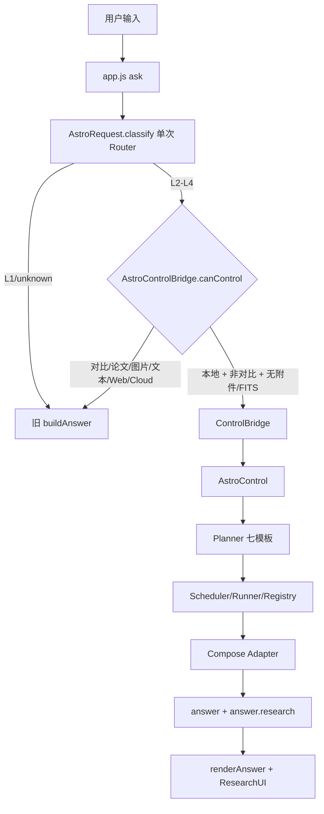
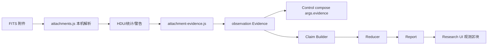
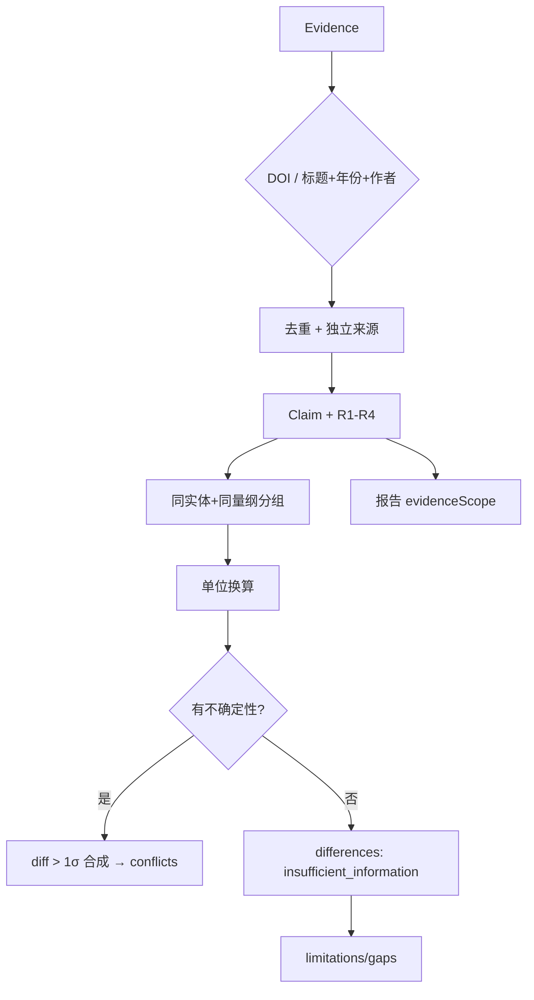

# ASTRUM V1.2 架构更新

> 日期：2026-11-01
> 范围：统一入口扩展、FITS 附件、SIMBAD 多主机、科学质量规则
> 原则：复用 V1.1，不重写旧业务。

---

## 1. 统一入口（V1.2）



`canControl` 条件：
```
info.control === true
&& mode !== 'compare'
&& sourceType === 'local'
&& (attachments 为空 或 全部为已解析 FITS)
```

---

## 2. FITS 附件数据流



- 不重新读取/上传文件；只消费已解析结果。
- 文件名不作为观测结果；Header 不作为完整科学结论。
- 不支持附件不生成 Evidence，只进 gaps。
- 不新增第八模板；Evidence 通过 compose args 注入。

---

## 3. SIMBAD 多主机

```
HOSTS:
  1 simbad.harvard.edu       （本机可用，CORS *）
  2 simbad.u-strasbg.fr
  3 simbad.cds.unistra.fr
```

- 逐主机尝试；超时/网络错误才切换。
- `not-found` 不继续切换、不推断目标不存在。
- 返回 `host/from` 写入 Evidence provenance。
- CSP connect-src 增加 Harvard 主机。
- 真实查询 M42/M31/M4 已在 Node 与 Chrome 验证。

---

## 4. 科学质量链路



关键接口：
- `AstroEvidence.evidenceKey/normTitle`
- `AstroReducer.compareClaims/conflictsOf/differencesOf/convertValue`
- `AstroReport.build` 新增 `evidenceScope/differences/limitations`
- `AstroResearchUI.render` 显示 evidenceScope 与 limitations

向后兼容：
- `conflictsOf` 仍返回数组；
- `conflicts` 只在显著差异时出现；
- `differences` 单独保存“信息不足”的差异。

---

## 5. 场景与兼容边界

| 场景 | 路径 | 边界 |
|---|---|---|
| L1 | 旧链路 | 不改写 buildAnswer |
| 本地 L2-L4 | Control | routeData 复用，一次 Router |
| FITS 附件 | Control + 附件 Evidence | 仅全部 FITS |
| 论文/图片/文本 | 旧链路 | 不伪造全文 |
| 显式对比模式 | 旧 compare | 不迁移语义 |
| Web/Cloud | 旧 Research/模型 | 保留旧能力 |
| 控制层失败 | 旧 buildAnswer 回退 | 保留 `control_missing` |

---

## 6. 性能与取消

- 同一目标不重复取数（B8 测试）。
- 恢复任务不重跑成功步骤（v1c / v1.1 E2E）。
- FITS 附件只解析一次，Evidence 由缓存结果构造。
- Scheduler 仅取数层并行，compose 串行。
- 取消 → pending aborted、在飞 pendingAbort、TaskState ABORTED。
- 重试仍只限幂等工具、timeout/network/rate_limit，最多 1 次。

---

## 7. 部署

- 所有资源相对路径；无本地绝对路径。
- 新模块加入 index.html 顺序：request → bridge → attachment-evidence → research-ui → app。
- standalone 重新构建通过（50 内联脚本，未入库）。
- CSP 仅新增 `simbad.harvard.edu`，未放宽其他策略。
- GitHub Pages 远端未部署（DEFERRED）；本地 HTTP 等价验证通过。
