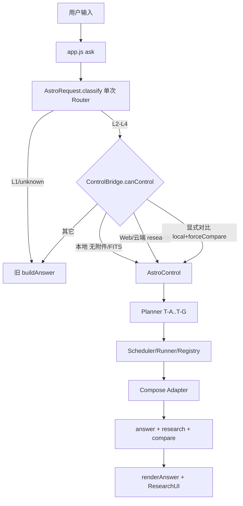
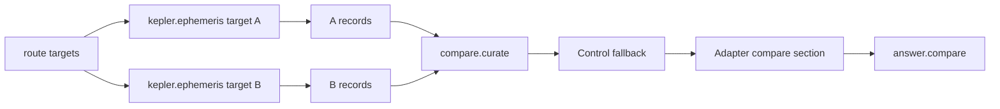
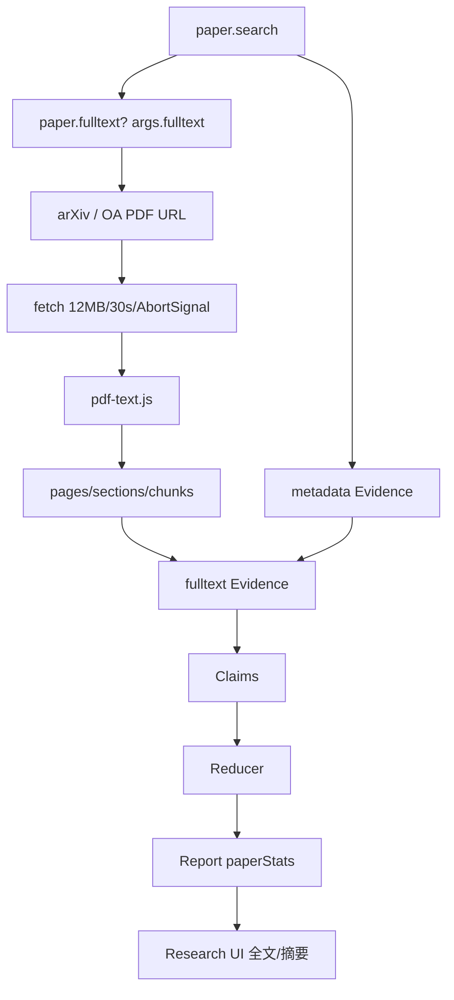

# ASTRUM V1.3 架构更新

> 日期：2026-11-01
> 范围：全场景统一入口、显式对比、论文全文、科学证据分层
> 原则：复用 V1/V1.1/V1.2，不重写旧业务。

---

## 1. 全场景统一入口



### 分流条件

```
info.control === true
AND (
  本地 && (无附件 || 全 FITS)
  OR 非本地 && route.mode === 'research' && (无附件 || 全 FITS)
  OR mode === 'compare' && forceCompare && local && 无附件
)
```

- L1 永不进入 Control。
- Router 一次；Control 复用 `routeData`。
- 云端 research 进入 Control，但旧云模型表述不再调用（功能取舍，登记 PARTIAL）。
- 显式对比使用 `forceCompare → Planner T-D`，不新增模板。

---

## 2. 显式对比数据流



- 每个目标独立记录；缺失目标不生成对比项。
- 单位/参考系/历元差异由 Reducer 标记，不直接比较。
- compose 不修改；compare section 只在 Adapter fallback 追加。
- 纯计算对比没有外部 Evidence，不生成 Research Report；多目标研究（T-E/T-F）才生成报告。

---

## 3. 论文全文流水线



### 模块

| 模块 | 职责 |
|---|---|
| `core/pdf-text.js` | PDF 字节 → 文本/章节/分块/页码（Flate、对象流、内容流） |
| `core/paper-fulltext.js` | URL 解析、下载、限制、缓存、Evidence |
| `core/registry.js` | `paper.search` 扩展 `fulltext/fulltextItems/maxFulltext`，不新增工具 |
| `core/compose-adapter.js` | 收集 `fulltexts[].evidence`、compare section |
| `core/report.js` | 论文分组、paperStats、全文范围、limitations |
| `core/research-ui.js` | 统计与全文/摘要标记 |

### 不做

- 不改 `compose*`、`toSections()`、`buildAnswer()`。
- 不新增第八模板、不新增 13 个工具（保持 12）。
- 不绕过付费墙/登录/版权。
- 不引入 PDF.js 等强制运行时；使用零依赖解析器。
- 不上传 PDF 到任何后端。

---

## 4. Evidence 分层

```text
contentLevel: metadata | abstract | fulltext
Evidence Key:
  doi:<doi>|abstract
  doi:<doi>|fulltext|<chunkId>
  title:<title>|<year>|<author>|abstract
```

- 摘要与全文同 DOI 不互相覆盖。
- 独立来源仍按 `sourceId`/DOI 计 1。
- fulltext Evidence 带 section/pageStart/pageEnd/sourceUrl/extractionMethod。
- Claim 只引用 evidenceRefs；Report 用 `evidenceScope` 区分。

---

## 5. 资源与取消

| 限制 | 值 |
|---|---|
| PDF 大小 | 12 MB |
| 下载超时 | 30 s |
| 页面上限 | 40 |
| 正文字符 | 200,000 |
| 分块上限 | 40 |
| 单篇 Evidence 块 | 6（Control 4） |
| 每次论文数 | 1（最多 3） |
| 缓存 | 8 篇 LRU |

- AbortSignal 贯穿 Control → Registry → PaperFulltext.fetchPdf。
- 解析前检查取消；解析中不做 CPU 抢占（登记限制）。
- 失败分类：`not_pdf / pdf_encrypted / pdf_too_large / pdf_no_text / timeout / network / cancelled / fulltext_unavailable`。

---

## 6. 部署与兼容

- 新模块加载：`pdf-text.js`、`paper-fulltext.js` 在 `paper.search` 前。
- CSP 新增 `https://arxiv.org`、`https://export.arxiv.org`；未放宽 object/base/form 等。
- standalone 51 内联脚本，约 1560 KB；file:// selftest 通过。
- 20 问 sections 逐字节一致；旧 366 基线通过。
- 13 Agent / TRACE_ORDER / Critic 五項 / Qty 保持不变。
